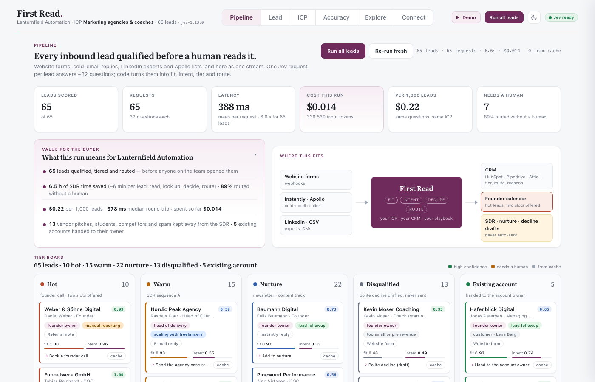

# First Read — inbound lead qualification for an agency's client

First Read qualifies every inbound lead before a human reads it. Website forms, cold-email replies, LinkedIn DMs and exported profiles all go through one **Jev** (TypeSafe System One) request per lead, which answers ~32 atomic questions about fit, pain and buying intent. Ordinary code turns those answers into an ICP fit score, a tier (Hot, Warm, Nurture, Disqualify, Existing account), a CRM duplicate check, a route and a next action from a fixed playbook. It costs about $0.22 per 1,000 leads and gets all 65 demo leads right, and every decision shows the exact sentences that drove it.



## Run it

```bash
cp .env.example .env      # then set TYPESAFE_API_KEY (APOLLO_API_KEY is optional)
./run.sh serve            # http://127.0.0.1:8780
```

Needs Python 3.13 and [uv](https://docs.astral.sh/uv/). Without a key the app still starts and every page renders; scoring shows an "add your TypeSafe key" message until you add one. Click **Run** on the Pipeline page to score all 65 leads (~6 s).

> **The demo data is fictional.** The client *Lanternfield Automation*, its closer *Elena Marquardt*, all 65 leads, the companies and people in them, and the CRM accounts are invented (see `scripts/make_dataset.py`). Any resemblance to real companies or people is coincidental.

## Overview

Fictional client: **Lanternfield Automation**, an agency that sells AI-automation implementation to marketing agencies and coaches. The product is what an agency would build *for* a client like that: the client's ideal customer profile in plain English (`data/icp.json`) becomes Jev's answer space; weights, thresholds and routes stay in code. Two more presets (B2B SaaS founders, e-commerce brands) show that one build serves many clients.

```bash
./run.sh serve            # http://127.0.0.1:8780
./run.sh test             # 74 unit tests, mocked Jev, offline, < 1 s
./run.sh test-all         # + 8 integration tests against the real API (65 requests ≈ 1.5 cents)
./run.sh shots            # Playwright screenshots, light + dark → reports/ui/
./run.sh score            # CLI: score every lead, print tier accuracy vs gold
./run.sh dataset          # regenerate data/leads, data/crm.json, data/gold.json
```

Stack: Python 3.13 + uv, FastAPI, one HTML page with plain CSS/JS (no build step). Model pinned to `jev-1.13.0`.

`run.sh` reads `TYPESAFE_API_KEY` (or its alias `JEV_API_KEY`) and the optional `APOLLO_API_KEY` from your environment or a local `.env` (gitignored; copy `.env.example`). Keys stay server-side and are never logged. The Apollo enrichment reads `APOLLO_API_KEY` from the environment only and is off unless `APOLLO_ENRICH=1`. `./run.sh shots` needs Playwright's Chromium once: `uv run playwright install chromium`.

---

## What the buyer sees

| Page | What it does |
| --- | --- |
| **Pipeline** | Streams all 65 leads (SSE), header counters (leads, requests, latency, cost, cost per 1,000, needs-a-human), a **Value for the buyer** card (leads qualified, SDR minutes saved at 6 min/lead, cost per 1,000, share auto-routed, pitches kept away, duplicates handed over), a **Where this fits** strip, and the tier board: Hot · Warm · Nurture · Disqualified · Existing account. Cards: company, persona chip, primary pain chip, fit and intent bars, confidence pill, next action. |
| **Lead** | The three inputs (message, company profile, person/bio) with **Jev's evidence sentences highlighted** per pain (colour) and for buying intent (underline); the fit × intent quadrant with per-component contributions; the ICP checklist (size and revenue are *stated or unknown*, never guessed); qualifying pains with probabilities; the CRM dedupe shortlist with P(same); the playbook action with its filled template; **what would move it up a tier**; every raw answer. |
| **ICP** | The editor: industries, personas (weighted), pains (weighted), disqualifiers, target size bands, minimum revenue band, maturity fit vector, fit and intent weights, tier thresholds, routes. **Live re-scoring from cache**: every slider move re-tiers all leads with zero API calls and lists who moved. A **What a run would ask** card counts stale questions; adding a pain re-asks exactly its two questions. Presets: Marketing agencies & coaches · B2B SaaS founders · E-commerce brands. |
| **Accuracy** | Tier / persona / primary-pain accuracy against the hidden gold labels, split into *auto-routed* vs *flagged for a human*; confusion matrix; per-tier precision and recall; a clickable list of misses. |
| **Explore** | Fit × intent scatter of all leads coloured by tier, filters by industry / persona / pain / tier; a **pain heatmap** (pain × Hot/Warm/Nurture) with the headline: "4 of 10 Hot leads name manual reporting" — positioning intel for the client. |
| **Connect** | Inputs (website forms, Instantly/Apollo replies, LinkedIn exports/DMs, shared inbox), outputs (HubSpot/Pipedrive/Attio properties, founder calendar, SDR sequence, nurture list, decline drafts), optional **Enrich via Apollo**, the privacy card, a Jev connection test. |
| **Demo** | Slide-in panel with six one-click beats and a buyer caption each (see `DEMO.md`). |

Screenshots (light and dark) of every page and the demo panel are in `reports/ui/`.

---

## Architecture

```
inbound lead (message · company · person)          data/leads/*.json
        │
        ▼
leads.py        state = {lead_source, company, person, message, sentences{S1..,N1..,B1..}}
                (never e-mail or phone)
        │
dedupe.py       code shortlists ≤10 CRM accounts by domain / name similarity / contact name
        │
constants.py    build_questions(icp, sentence_ids, crm_candidates, playbook) → ~32 typed questions
        │       fingerprint(question) per id
cache.py        answers stored per (lead, question fingerprint); only missing ones are asked
        │
jev.py          ONE POST /v1/systemone per lead, all questions in parallel  (~330 ms p50, ~5,200 tokens)
        │
scoring.py      fit = Σ w·component · intent = Σ w·signal · tier matrix · disqualifier overrides
                · CRM match → existing · confidence gating → hold · route · playbook action · move-up text
        │
server.py       FastAPI: SSE run, per-lead detail, ICP PUT/rescore, metrics, Apollo, static UI
web/            index.html · app.css · app.js · demo.js
```

Design rules from the TypeSafe docs applied throughout: one atomic judgement per question; Score levels are concrete situations, not adjectives; every Choice has an `other` / `none` / `not_stated` option; arithmetic, thresholds and routing live in code; questions only relevant to a written message are not asked about a bare profile (asking "is this message spam?" about `null` yields a confident *yes* — the literal-reading failure mode).

### Per-question usage (built from the ICP for every lead)

| Group | Question id | Type | What it decides | Used by |
| --- | --- | --- | --- | --- |
| Fit | `industry` | Choice: ICP industries + `other` | industry fit = 1 − P(other) | fit weight `industry` |
| Fit | `company_maturity` | Score, 5 situations (pre-revenue → large) | maturity fit = Σ P(level) × `icp.maturity_fit[level]` | fit weight `maturity` |
| Fit | `size_band_stated` | Choice: bands + `not_stated` | stated size outside `target_size_bands` → fit × 0.8 | penalty, checklist |
| Fit | `revenue_band_stated` | Choice: bands + `not_stated` | stated band below `min_revenue_band` (conf ≥ floor) → **disqualify** | revenue gate |
| Fit | `geo_fit` | Noul | P < 0.3 → fit × 0.85 | penalty |
| Fit | `dq_<id>` (×4) | Noul per ICP disqualifier | ≥ `disqualifier_p` → **disqualify** | override |
| Relevance | `persona` | Choice: ICP personas + `other` | persona fit = Σ P(persona) × weight | fit weight `persona` |
| Relevance | `decision_authority` | Score, 4 levels | shown on the checklist | UI |
| Relevance | `is_vendor_pitch` · `is_student_or_jobseeker` · `is_competitor` | Noul | ≥ `disqualifier_p` → **disqualify** | override |
| Pain | `pain_<id>` (×5) | Noul per ICP pain | pain fit = max weighted P + 0.2 × rest; primary pain = argmax ≥ `pain_p` | fit weight `pains`, heatmap |
| Pain | `evidence_<id>` (×5) | Choice over sentence ids + `none` | which sentence carries the pain → highlight | Lead page |
| Intent | `purchase_intent` | Score, 5 levels (no intent → ready to buy) | ×0.5 | intent |
| Intent | `intent_evidence` | Choice over sentence ids + `none` | which sentence shows buying intent → underline | Lead page |
| Intent | `timeline_stated` | Choice: this_month / this_quarter / later / not_stated | Σ P × {1, .6, .2, 0} × 0.1 | intent |
| Intent | `budget_signal` · `urgency` · `asks_for_meeting` | Noul | × 0.1 · × 0.1 · × 0.2 | intent |
| Intent | `objection_present` | Choice: price / timing / trust / none | timing (≥ .6) parks a Warm lead on Nurture; shown as a flag | rule, UI |
| Quality | `is_spam_or_automated` | Noul (message only) | ≥ `spam_p` → disqualify before anything else | override |
| Quality | `contains_pii_request` | Noul (message only) | ≥ 0.7 → security-review flag, route on hold | gating |
| Dedupe | `same_account` | Choice: ≤10 shortlisted CRM accounts + `none` | P(chosen) ≥ `dedupe_p` → **existing account**, route to owner | override |
| Action | `next_best_action` | Choice over the playbook | argmax among actions allowed for the tier; disqualify/existing are fixed | next action |

Everything above is one request. A message lead gets ~34 questions, a bare profile ~27. `./run.sh questions` prints the exact JSON for a lead.

### Composite scoring and the tier matrix (code)

```
fit    = (0.35·industry + 0.20·maturity + 0.20·persona + 0.25·pains) × size_penalty × geo_penalty
intent = 0.5·purchase_intent/4 + 0.2·asks_for_meeting + 0.1·budget + 0.1·urgency + 0.1·timeline

                intent ≥ .60     .25 ≤ intent < .60     intent < .25
fit ≥ .62       HOT              WARM                   NURTURE
.42 ≤ fit       WARM             WARM                   NURTURE
fit < .42       WARM (flagged)   NURTURE                NURTURE
```

Order of overrides: spam → disqualify · CRM match → existing account · any disqualifier (incl. revenue gate) → disqualify · matrix · timing objection demotes Warm to Nurture.

**Confidence gating.** A lead is flagged *needs a human* (route on hold) when the industry or purchase-intent confidence is below `confidence_floor` (0.55), when fit or intent is within 0.03 of a tier threshold, when intent is strong but fit is weak, when the strongest disqualifier is below 0.85, when a CRM match is below 0.80, or when the message asks for personal data. The Accuracy page scores flagged and auto-routed leads separately.

**Routes** (from the ICP): Hot → founder call with two proposed slots (next Tue 11:00 / Thu 15:00, computed in code) · Warm → SDR sequence A · Nurture → newsletter/content track · Disqualify → polite decline *drafted, never auto-sent* · Existing → the CRM account owner.

**Next best action** comes from a fixed playbook (`data/playbook.json`): Jev picks, code constrains the pick to actions allowed for the tier and fills the template (`{first_name}`, `{company_name}`, `{industry_label}`, `{account_owner}`).

### Cache invalidation

Every answer is stored with the SHA-1 fingerprint of the question that produced it. The ICP lives in the question *criteria*, not in the state, so:

- editing one pain's description changes exactly `pain_<id>` and `evidence_<id>`;
- adding a pain adds two questions (one for leads with no sentences);
- weights, thresholds, the minimum revenue band and routes touch no question → **re-scoring is free** (`POST /api/rescore`, zero API calls).

Measured: the full run costs ~5,200 input tokens per lead; a re-run after adding a pain costs ~760 tokens per lead (the state is re-sent, the two new questions are asked).

### Dedupe (entity alignment)

Code is generous: exact registrable-domain match, `difflib` name similarity ≥ 0.72, shared name tokens (after stripping GmbH/agency/etc.), or a contact name on the account all shortlist a CRM record. Jev answers one Choice over the shortlist plus `none`. The dataset includes Kontor Süd (Munich) vs the CRM's Kontor Nord (Hamburg): shortlisted by code, rejected by Jev with P(none) ≈ 1.0.

---

## Dataset

`scripts/make_dataset.py` writes **65 synthetic leads** (`data/leads/L001.json` …), **12 CRM accounts** (`data/crm.json`) and the hidden **gold labels** (`data/gold.json`: tier, best persona, primary pain, note). Three input shapes are mixed: 44 inbound messages (website form, LinkedIn DM, e-mail / Instantly replies, a referral note), 12 company profiles from an Apollo-style export with a news snippet, and 9 LinkedIn-style executive bios. Every lead links a person and a company; messages are optional. Everything is invented and authored by hand (not model-generated) so each lead has a known reason for its gold tier; `OPENAI_API_KEY` is not used.

Gold distribution: 10 Hot · 15 Warm · 22 Nurture · 13 Disqualified (vendor pitches, a student, a job seeker, competitors, an enterprise, a pre-revenue coach, a €6k/month freelancer, SEO spam, a phishing notice) · 5 Existing accounts (a customer writing again, a second contact at a customer, an open opportunity chasing a proposal, a churned account returning, a LinkedIn export of a customer's COO).

Named demo leads: `L001` the vague-but-hot inbound · `L047` polished vendor pitch · `L048` thesis interview · `L060` duplicate of CRM account Hafenblick Digital · `L006`, `L020`, `L025` state €15–22k/month and flip to Disqualified when the minimum revenue band is raised · `L022`, `L033` mention client churn for the "add a pain" beat · `L065` the dedupe near-miss.

## Accuracy, cost, latency (real API, `jev-1.13.0`)

Measured with `./run.sh score` on 2026-09-23 (fresh cache, 65 requests):

| | |
| --- | --- |
| Tier accuracy vs gold | **65 / 65 = 100 %** (adjacent-tier 100 %); first pass before tuning was 92.3 % with every miss flagged for a human |
| Persona accuracy | 47 / 47 |
| Primary-pain accuracy | 46 / 46 |
| Auto-routed vs flagged | 59 auto-routed at 100 %, 6 flagged for a human at 100 % |
| Requests | 65 (one per lead), ~5,200 input tokens per lead |
| Cost | **$0.0141 for 65 leads → $0.22 per 1,000 leads** |
| Latency | mean 375 ms, p50 359 ms per request; 65 leads stream in ~6 s with 4 workers |
| Add-a-pain re-run | 127 questions in 5.3 s for $0.0021 (~760 tokens per lead) |

Honest notes: the dataset and the thresholds were tuned together — the integration test asserts ≥ 0.80, not 1.0, and repeat runs move about ±1 lead near the Warm/Nurture boundary (intent ≈ 0.25); those leads carry the *needs a human* flag, which is what the flag is for. Three leads have no sentences at all (bare profiles without news), so they get no evidence questions.

---

## API

```
GET  /api/status                 model, ICP summary, counts, key presence (never the key), cache stats, Apollo flag
GET  /api/leads · /api/leads/{id}
GET  /api/results                every cached result re-scored under the live ICP (0 Jev calls) + totals + metrics
GET  /api/run/stream?force=&ids= SSE: start, result*, progress*, failed*, done | fatal
POST /api/score/{id}?force=      one lead now
POST /api/rescore  {icp}         results under an unsaved ICP, cache only; reports what a run would re-ask
GET/PUT /api/icp · POST /api/icp/reset · GET /api/icp/presets · POST /api/icp/presets/{id}
GET  /api/questions?lead_id=     the question set for a lead (ids, types, groups, raw JSON)
GET  /api/playbook · /api/crm · /api/metrics
POST /api/apollo/enrich {domain} optional, flagged
GET  /api/jev/test · DELETE /api/cache
```

URL shortcuts: `/?demo=1` opens the panel · `/?run=fresh` runs on load · `/?lead=L001` opens a lead · `/?theme=dark`.

## Connectors

The Connect page describes the production wiring; this repo ships the scoring core and the UI. Inputs: website forms (webhooks), Instantly/Apollo reply webhooks, LinkedIn / CSV exports, a read-only shared inbox. Outputs: CRM properties (HubSpot, Pipedrive, Attio) — tier, route, fit, intent, primary pain, reasons, next action; existing accounts get a note, not a new record; Hot leads get two proposed slots; Warm leads a sequence; Nurture a list; Disqualified a *draft* decline.

**Apollo enrichment** (`APOLLO_ENRICH=1` + `APOLLO_API_KEY`) is a read-only organisation lookup by domain, cached in `data/cache/apollo/`; any failure degrades to "not enriched" and nothing else depends on it. During development the stored key returned HTTP 401 from Apollo's enrich endpoint, so the button shows that message rather than data; Jev never sees Apollo output unless you paste it into a lead.

## Privacy

- Sent to Jev per lead: company name, domain, description, size, location, services, news; person name, title, location, bio; the message text; the ICP option texts. **Never** e-mail addresses or phone numbers (`Lead.to_state`, tested).
- Nothing is generated: Jev returns probabilities over options the client defined. Decline drafts are templates filled in code and never sent automatically.
- A message that asks for credentials or personal data (`contains_pii_request`) is flagged for security review and never routed automatically.
- Answers are cached per lead and question under `data/cache/` (git-ignored); `DELETE /api/cache` forgets everything. The API key is read from `TYPESAFE_API_KEY` (fallback `JEV_API_KEY`) server-side and never logged or sent to the browser.

## Fake mode

`FIRSTREAD_FAKE=1 ./run.sh serve` runs the whole UI on a deterministic keyword-based stand-in (`leadqualifier/fake_client.py`) — no key, no network. It is used by the unit tests; it is not accurate and says so in the status pill.

## Layout

```
lead-qualifier/
  leadqualifier/     config · constants (questions) · icp · leads · dedupe · cache · jev · scoring · pipeline · metrics · apollo · fake_client · server · cli
  web/               index.html · app.css · app.js · demo.js
  data/              icp.json (live) · icp_presets/ · playbook.json · crm.json · gold.json · leads/ · cache/ (git-ignored)
  scripts/           make_dataset.py · ui_screenshots.py
  tests/             unit (mocked) + test_integration.py (real API)
  reports/ui/        screenshots
  run.sh · pyproject.toml · .env.example · DEMO.md
```

## License

MIT, see [LICENSE](LICENSE).
