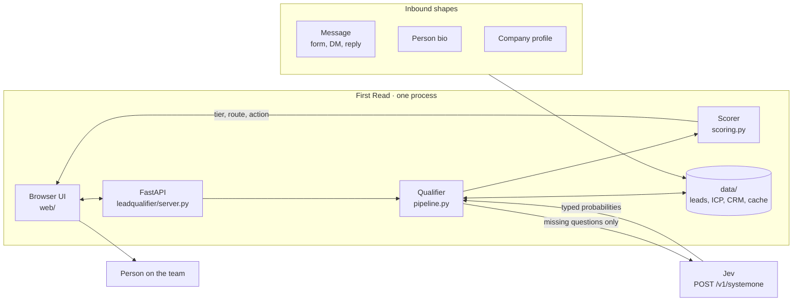
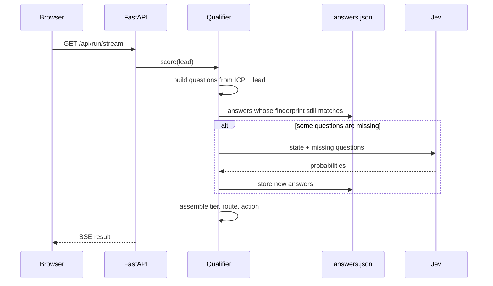
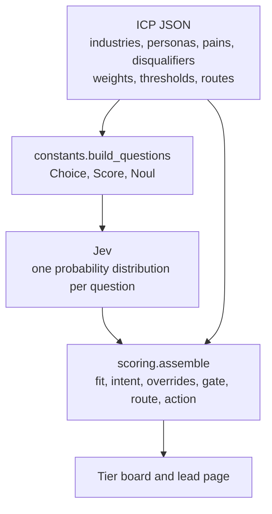
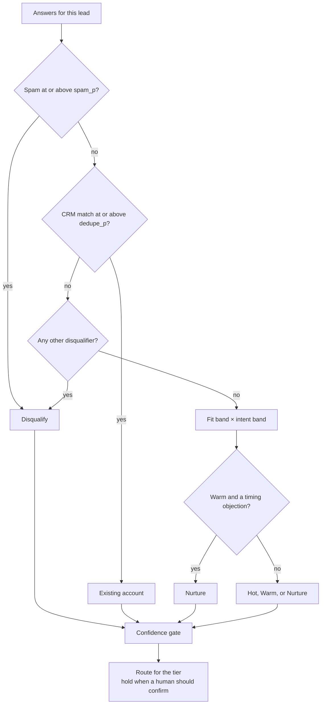
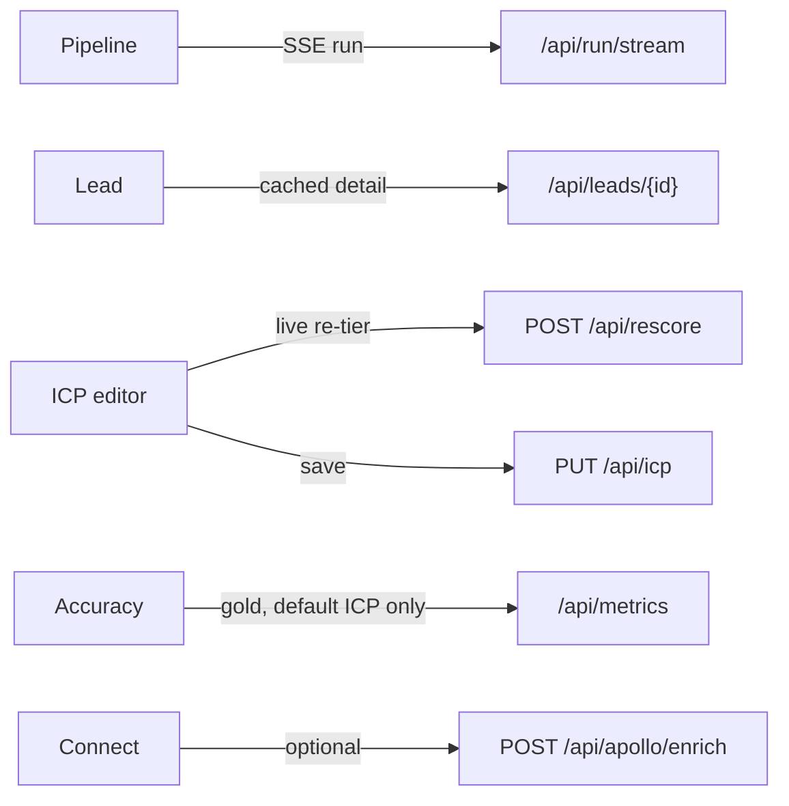

# First Read — architecture at a glance

Date: 2026-11-17. This is the short map. The module-level write-up is [ARCHITECTURE.md](ARCHITECTURE.md).

First Read qualifies an inbound lead before a person opens it. One request to Jev (TypeSafe System One, model `jev-1.13.0`) answers a set of atomic questions about that lead. Ordinary Python turns those probabilities into a fit score, an intent score, a tier, a route, and a next action. The ideal customer profile (ICP) is data. Weights, thresholds, and routing stay in code.

The demo ships 65 fictional leads, 12 CRM accounts, and hidden gold labels for the default ICP (`lanternfield_agencies`, client Lanternfield Automation).

## The system in one picture

`./run.sh serve` starts one uvicorn process on `127.0.0.1:8780`. The browser is a single HTML page with plain CSS and JS. There is no build step and no database.

## One lead, one request

A full cache hit asks Jev nothing. Changing a weight or a threshold re-scores from cache. Changing a pain's wording changes that question's fingerprint, so the next run asks only the questions that moved.

## Who decides what

Jev never sees the arithmetic. The ICP text lives in question criteria. The lead state is the company, the person, the message, and sentence ids. Email addresses and phone numbers stay off that state.

## How a tier is chosen

Overrides run first. The matrix runs only when none of them fire.

Default bands on the Lanternfield ICP: fit hot `0.62`, fit warm `0.42`, intent hot `0.60`, intent warm `0.25`.

| | Intent high | Intent mid | Intent low |
| --- | --- | --- | --- |
| Fit high | Hot | Warm | Nurture |
| Fit mid | Warm | Warm | Nurture |
| Fit low | Warm, flagged | Nurture | Nurture |

Fit is a weighted mix of industry, maturity, persona, and pain, then a size penalty and a geography penalty. Intent is a weighted mix of purchase-intent level, a meeting ask, budget, urgency, and timeline. A bare profile cannot ask for a meeting, so those message-only signals stay at zero.

## What the browser talks to

Apollo enrichment is a side lookup by domain. It is off unless `APOLLO_ENRICH=1` and `APOLLO_API_KEY` are both set. Its result never enters a Jev request. The three Apollo roles (live lookup, export-shaped demo leads, and the Connect copy) are in [how First Read uses Apollo](apollo/2026-11-17-how-first-read-uses-apollo.md).

## Where the code lives

| Piece | Role |
| --- | --- |
| `leadqualifier/server.py` | HTTP, SSE jobs, in-memory app state |
| `leadqualifier/pipeline.py` | One lead or many; cache merge; thread pool |
| `leadqualifier/constants.py` | Question texts, model pin, fingerprints |
| `leadqualifier/scoring.py` | Fit, intent, tier, gate, route, action |
| `leadqualifier/jev.py` | HTTP client, retries, cost |
| `leadqualifier/cache.py` | `data/cache/answers.json` |
| `leadqualifier/dedupe.py` | Generous CRM shortlist, at most 10 |
| `web/` | The six pages and the demo panel |
| `data/` | Live ICP, presets, leads, CRM, playbook, gold |

`FIRSTREAD_FAKE=1` swaps in `fake_client.py`. The UI still renders. The status pill says the numbers are a stand-in.

## Reading next

[ARCHITECTURE.md](ARCHITECTURE.md) covers the question set, the cache key, the assemble order, the SSE job, and the failure paths.
