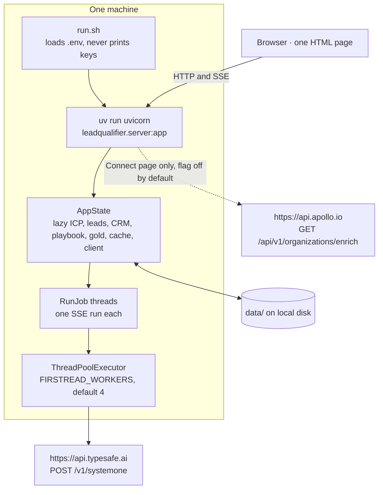
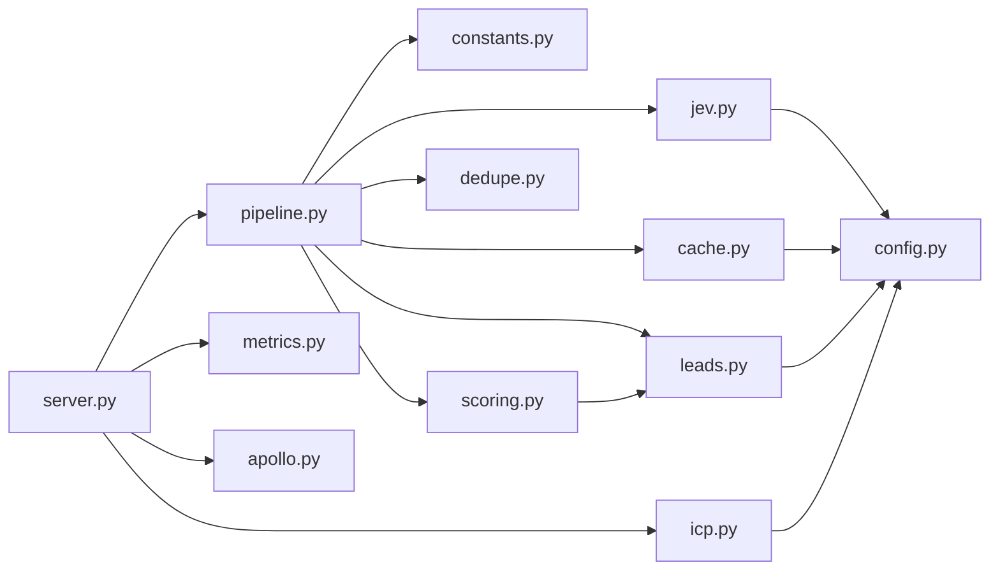
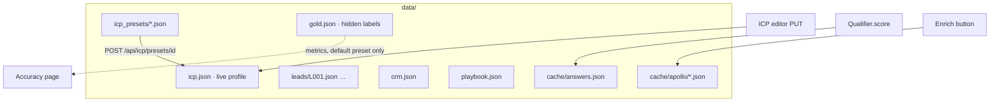
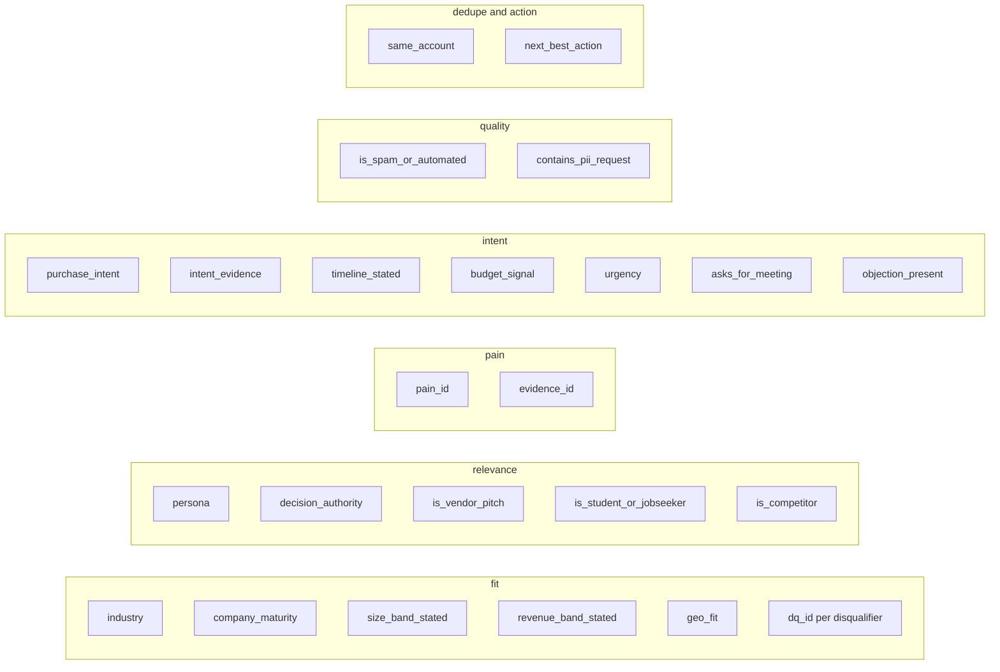
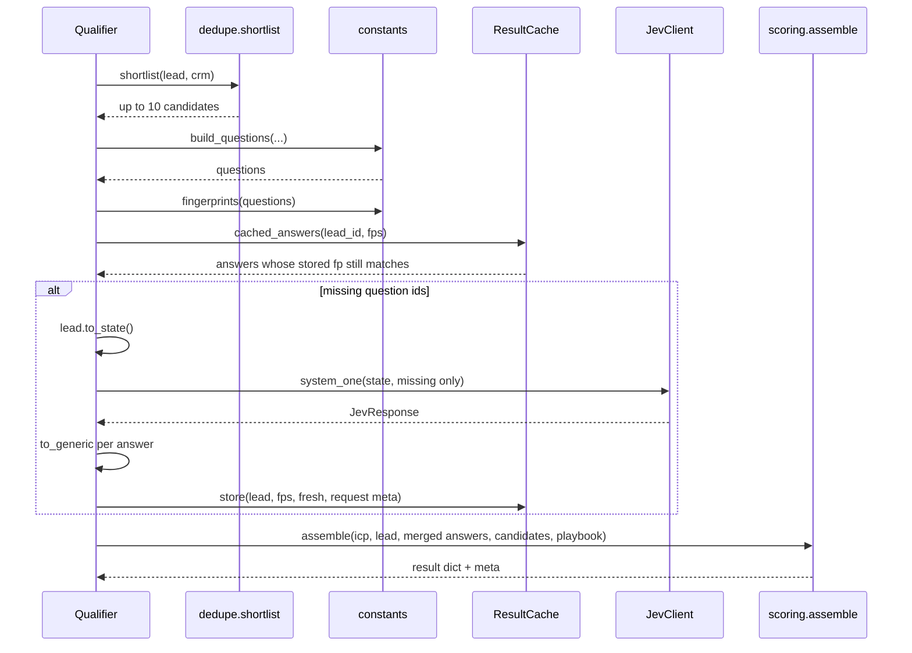
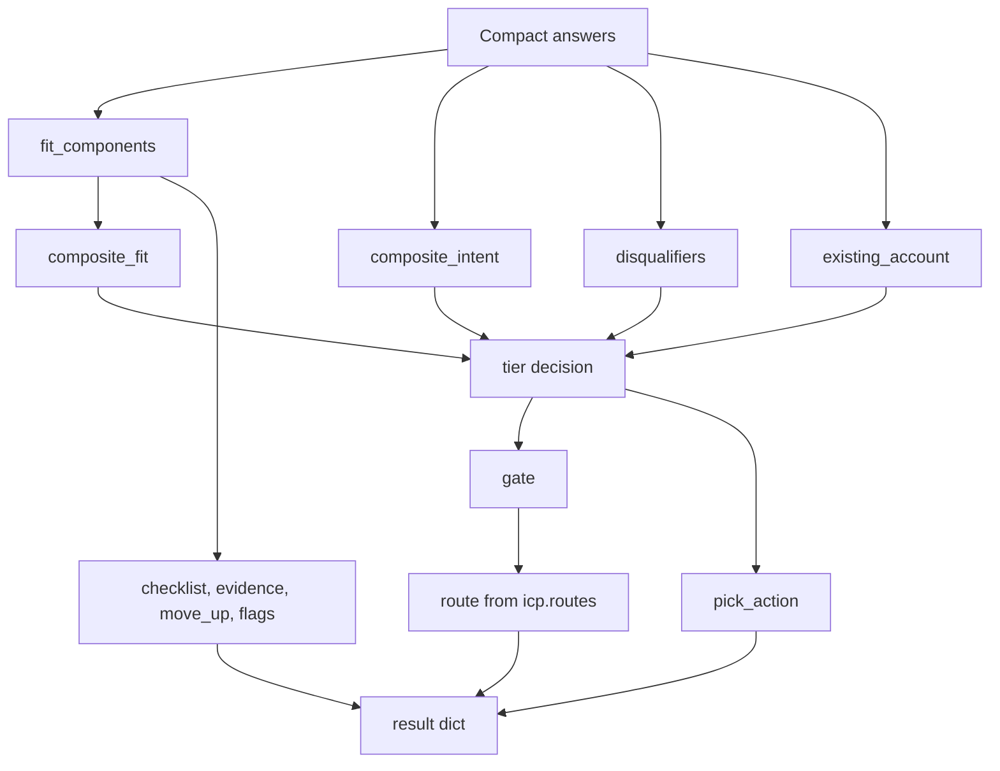
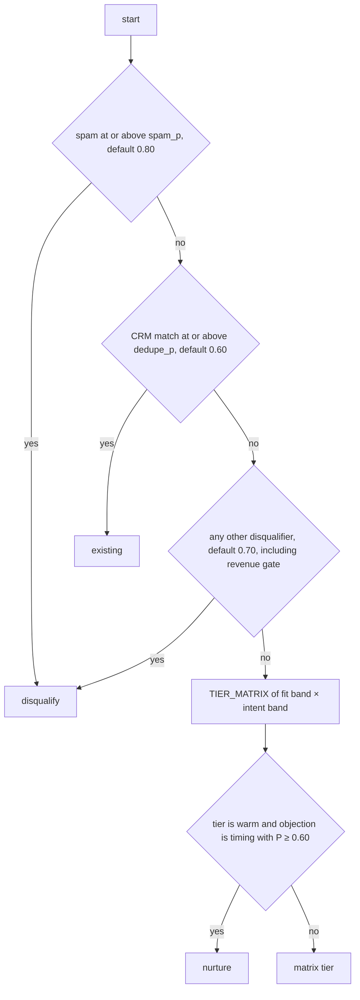
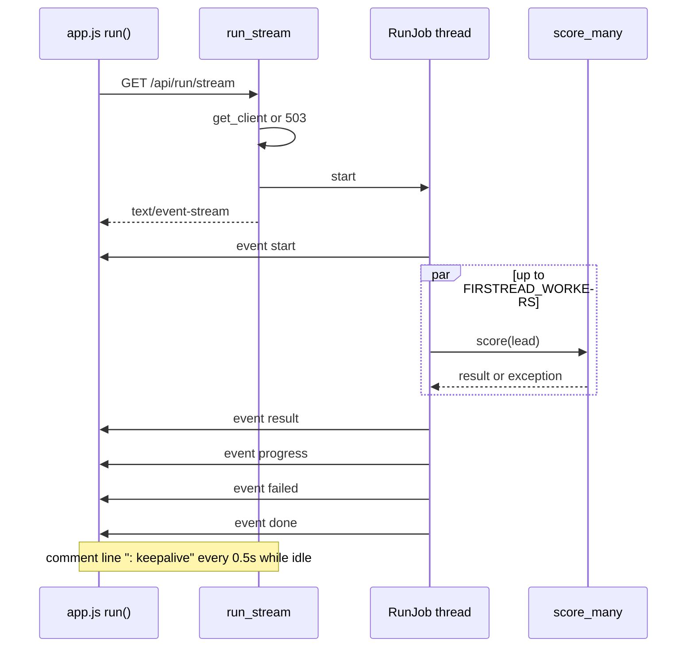
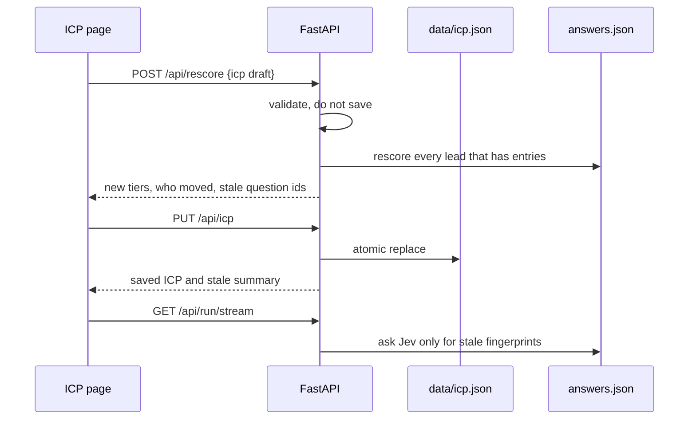

# First Read — architecture

Date: 2026-11-17. The short map is [ARCHITECTURE-AT-A-GLANCE-v1.md](ARCHITECTURE-AT-A-GLANCE-v1.md). This note is the one to use when changing scoring, the question set, the cache, or the API.

## 1. Job of the system

First Read takes one inbound lead — a message, a company profile, a person bio, or a mix — and produces a decision a closer or an SDR can act on:

- **fit** and **intent**, each in `0..1`, with the contribution of each component
- a **tier**: `hot`, `warm`, `nurture`, `disqualify`, or `existing`
- a **route** from the ICP, held when confidence is low or the score sits on a threshold
- a **next action** from `data/playbook.json`, filled with the lead's name and company
- the **sentences** that carry a pain or the buying intent, so the lead page can highlight them

Jev (TypeSafe System One) returns a probability distribution for each question. `leadqualifier/scoring.py` owns every weight, threshold, override, and route. The model is pinned to `jev-1.13.0` in `leadqualifier/constants.py`. Input tokens are priced at `$0.042` per million; output tokens are treated as free. Cost on a result is `input_tokens * price / 1_000_000`.

The product boundary is the scoring core and the UI. The Connect page describes website forms, Instantly or Apollo replies, LinkedIn exports, and CRM writes. Those connectors are documentation in the page. They are not running integrations, apart from the optional Apollo organisation lookup.

## 2. Processes and deploy shape



There is one Python process. `AppState` in `server.py` loads each dataset the first time a request needs it and keeps it in memory. ICP saves write `data/icp.json` and replace the in-memory copy. The answer cache is a single JSON file, written by replacing a temp file so a crash mid-write leaves the previous file.

`run.sh` reads `.env` without overriding variables already set in the shell. It accepts `TYPESAFE_API_KEY`, with `JEV_API_KEY` as an alias. Values that start with `your-` are ignored. The key is sent as a bearer token from `JevClient` and is absent from logs and from `/api/status` (that endpoint reports only whether a key is present).

| Entry | What it starts |
| --- | --- |
| `./run.sh serve` | uvicorn on `127.0.0.1` and `PORT` (default `8780`) |
| `./run.sh score` | `python -m leadqualifier.cli score` — same `Qualifier`, no HTTP |
| `./run.sh test` | pytest, integration tests excluded, `FakeClient` |
| `./run.sh questions` | print the question JSON for one lead |
| `FIRSTREAD_FAKE=1 ./run.sh serve` | `FakeClient` instead of `JevClient` |

`FakeClient` (`leadqualifier/fake_client.py`) returns the right answer shapes from keyword heuristics. Unit tests depend on it. The status pill marks fake mode so a demo does not present those numbers as Jev.

## 3. Module map



| Module | Owns | Does not own |
| --- | --- | --- |
| `config.py` | Paths, key lookup, worker count, Apollo flag | Question text, scores |
| `leads.py` | Load leads, CRM, playbook, gold; `Lead.to_state`; sentence split | Judgement |
| `icp.py` | Validate, save, presets, reset | Asking Jev |
| `constants.py` | Model pin, rubrics, `build_questions`, SHA-1 fingerprints | HTTP |
| `dedupe.py` | CRM shortlist by domain, name, contact | The same-account verdict |
| `jev.py` | `POST /v1/systemone`, retries, `JevResponse.cost_usd` | Which questions to ask |
| `cache.py` | Per-lead answers keyed by question id and fingerprint | Scoring |
| `pipeline.py` | `Qualifier.score`, `rescore`, `score_many` | Tier math |
| `scoring.py` | `assemble` and every numeric rule | The network |
| `metrics.py` | Accuracy vs `data/gold.json` | Anything but the default preset |
| `apollo.py` | Read-only org lookup, disk cache under `data/cache/apollo/`. See [how First Read uses Apollo](apollo/2026-11-17-how-first-read-uses-apollo.md) | The lead score |
| `server.py` | Routes, SSE `RunJob`, static files | Business rules |
| `cli.py` | Batch score and question dump | The UI |

`web/index.html`, `web/app.js`, `web/app.css`, and `web/demo.js` are the client. Pages are sections in one document. Navigation sets the hash (`#pipeline`, `#lead`, `#icp`, `#accuracy`, `#explore`, `#connect`). `/?demo=1`, `/?run=fresh`, `/?lead=L001`, and `/?theme=dark` are load-time shortcuts.

## 4. Data on disk



`data/cache/` is git-ignored. `DELETE /api/cache` clears answer entries and saves. Apollo failures are not cached, so a later call can succeed. Successful Apollo payloads are cached by a short SHA-1 of the domain.

A lead file has `id`, `source`, `received_at`, and any of `person`, `company`, `message`. `Lead.shape` is `message` when there is message text, otherwise `bio` when there is a bio, otherwise `profile`. The demo set is 44 messages, 12 profiles, and 9 bios.

`Lead.to_state` is the only document Jev receives for a lead:

| Included | Left out |
| --- | --- |
| `lead_source` label | email |
| company name, domain, description, size, location, services, news, founded | phone |
| person name, title, company, location, bio | CRM ids (those go on the `same_account` question, not the state) |
| message text, with subject prepended | the ICP itself (it lives in question criteria) |
| `sentences`: `S1..` message, `N1..` news, `B1..` bio, capped at 40 | |

Sentence ids are stable for a given text because the splitter is deterministic. Evidence questions are Choices over those ids plus `none`.

## 5. From ICP to questions

`constants.build_questions(icp, sentence_ids, crm_candidates, playbook, has_message)` returns a dict of question id to the raw System One body. Three types are used:

| Type | What comes back | Used for |
| --- | --- | --- |
| `choice` | `choice`, `confidence`, `probabilities` | industry, persona, size, revenue, timeline, objection, evidence sentence, CRM account, playbook action |
| `score` | `score`, level distribution, `confidence` | maturity (5 situations), authority (4), purchase intent (5) |
| `noul` | a single probability | pains, disqualifiers, geo fit, spam, meeting ask, budget, urgency, PII request |

Every Choice includes an escape option (`other`, `none`, or `not_stated`) so the distribution can sum to 1 without forcing a listed answer. Score levels are concrete situations written in `constants.py` (`MATURITY_LEVELS`, `AUTHORITY_LEVELS`, `INTENT_LEVELS`), not adjectives.



`MESSAGE_ONLY` questions are omitted when the lead has no message text: `is_vendor_pitch`, `asks_for_meeting`, `urgency`, `objection_present`, `is_spam_or_automated`, `contains_pii_request`. Asking "is this message spam?" about a null message is a known failure mode, so those questions are not built.

`same_account` exists only when `dedupe.shortlist` returns at least one CRM account. The shortlist is generous on purpose:

1. same registrable domain → score `1.0`
2. `difflib` name ratio ≥ `0.72` after stripping legal suffixes
3. shared name tokens
4. the lead's person name equals a contact on the account → score `0.9`

Floor is `0.45`. Cap is `MAX_CRM_CANDIDATES` (10). Jev then chooses among those ids or `none`. A code shortlist is not a match. `existing_account` in the scorer requires `P(chosen) ≥ thresholds.dedupe_p` (default `0.6`).

`next_best_action` is a Choice over every playbook entry. The scorer later throws away choices the tier is not allowed to take.

Fingerprints: `fingerprint(question)` is the first 16 hex chars of SHA-1 over `json.dumps(question, sort_keys=True)`. The ICP wording is inside `criteria`, so editing one pain changes `pain_<id>` and `evidence_<id>` and leaves every other fingerprint alone. Weights, thresholds, `min_revenue_band`, and routes are not inside any question, so they never invalidate cache.

## 6. Scoring one lead

`Qualifier.score` is the only path that may call Jev. `Qualifier.rescore` never does.



`JevClient.system_one` posts `{state, model, questions}` to `{BASE_URL}/v1/systemone` with a 30s timeout. It retries connection errors and HTTP `408, 429, 500, 502, 503, 504, 529`, up to 4 retries, backing off from `0.6s` and doubling, capped around 12s, honouring `retry-after-ms` when present. The request id is the `x-typesafe-request-id` header. A lead that throws is reported and the batch continues (`Qualifier._guarded`).

`to_generic` compacts the raw API answer into `{type, p}` for noul, or `{type, choice|score, confidence, probabilities}` for the others. That compact form is what the cache and the UI store.

Cache record, version 1, in `data/cache/answers.json`:

```text
entries[lead_id].answers[qid] = { fp, answer }
entries[lead_id].requests[]   = { qids, latency_ms, input_tokens, output_tokens, model, at }
```

The requests list is capped at the last 30. `store` is locked. `save` runs after `score_many`, after a single `POST /api/score/{id}`, and after a cache delete. A cache hit still returns a full result; `meta.n_asked` is `0` and `meta.cached` is true. `rescore` adds `meta.stale`, the question ids whose fingerprint is no longer in the cache. The lead page and the pipeline board render those cached results with zero Jev calls.

`stale_summary` walks every lead and counts missing fingerprints. The ICP page shows that count as "what a run would ask" before anyone spends a request.

## 7. Assemble order

`assemble` is a pure function of the ICP, the lead, the answers, the CRM shortlist, and the playbook. Tests call it directly.



### Fit

Component fits, then a weighted mean. Default Lanternfield weights: industry `0.35`, maturity `0.20`, persona `0.20`, pains `0.25`. Weights are normalised by their sum.

| Component | Formula |
| --- | --- |
| Industry | `1 - P(other)` on the industry Choice |
| Maturity | sum of `P(level) * icp.maturity_fit[level]` over 5 levels. Default vector `[0.05, 0.4, 1.0, 1.0, 0.35]` |
| Persona | sum of `P(persona) * persona.weight` |
| Pain | `min(1, max(weight * P) + 0.2 * sum of the other weighted pains)` |

Primary pain is the pain with the highest raw probability, cleared when that probability is below `thresholds.pain_p` (default `0.6`).

Penalties apply after the weighted mean, and only with enough confidence (`confidence_floor`, default `0.55`) where a Choice is involved:

- stated size band outside `target_size_bands` → fit `× 0.8`
- `geo_fit` below `0.3` → fit `× 0.85` (missing geo defaults to `1.0`, so silence is not a penalty)

Size and revenue that are `not_stated`, or stated below the confidence floor, stay unknown. The checklist says "not stated — never guessed".

### Intent

Default `intent_weights`: purchase intent `0.5`, asks for a meeting `0.2`, budget `0.1`, urgency `0.1`, timeline `0.1`.

| Part | Value |
| --- | --- |
| purchase_intent | score `/ 4` (five levels, `0..4`) |
| asks_for_meeting, budget_signal, urgency | the noul probability |
| timeline | `P(this_month)*1 + P(this_quarter)*0.6 + P(later)*0.2` |

Without a message, `asks_for_meeting` and `urgency` are forced to `0` before the weights are applied. A profile is scored on fit plus whatever intent the news and bio support.

### Tier



Disqualifiers collected by `disqualifiers`:

- each `dq_<id>` from `icp.disqualifiers`, when `P ≥ disqualifier_p`
- `is_vendor_pitch`, `is_student_or_jobseeker`, `is_competitor`, same threshold, skipped when an ICP disqualifier id already contains the matching word
- `is_spam_or_automated` at `spam_p` (this also short-circuits the tier to disqualify before the CRM check)
- stated revenue band strictly below `min_revenue_band`, with confidence at or above `confidence_floor`

Bands use the ICP thresholds (`fit_hot` `0.62`, `fit_warm` `0.42`, `intent_hot` `0.60`, `intent_warm` `0.25` on the default profile):

```text
                intent high          intent mid           intent low
fit high        hot                  warm                 nurture
fit mid         warm                 warm                 nurture
fit low         warm                 nurture              nurture
```

`band()` is `high` at or above the hot threshold, `mid` at or above the warm threshold, otherwise `low`.

### Gate, route, action

`gate` sets `confidence.needs_review` and a list of reasons. Any reason holds the route (`route.hold = true`). The lead still has a tier. The hold tells the UI to keep a human in the loop.

| Situation | Reason |
| --- | --- |
| Hot, warm, or nurture, and industry or purchase-intent confidence below `confidence_floor` | low confidence |
| Fit or intent within `0.03` of a hot or warm threshold | borderline |
| Fit low and intent high | strong intent, weak fit |
| Disqualify, and the strongest disqualifier probability is below `0.85` | confirm before declining |
| Existing, and the match probability is below `0.80` | confirm the account |
| `contains_pii_request` ≥ `0.7` | security review, no automatic reply |

Routes come from `icp.routes[tier]`. Hot adds two slots from `next_slots`: the next Tuesday 11:00 and the next Thursday 15:00, labelled CET, computed from `datetime.now()` unless a test passes `now`. Existing replaces the owner with the CRM account owner.

`pick_action` ranks playbook entries whose `tiers` include this tier, by Jev's probabilities, and fills `{first_name}`, `{company_name}`, `{industry_label}`, `{account_name}`, `{account_owner}`. Disqualify and existing ignore the Choice and use `decline_politely` and `route_to_account_owner`. If Jev's top allowed action is not the raw Choice, `source` is `jev-constrained`. If nothing allowed has probability, `source` is the fallback table in `scoring.py`.

`move_up` is a sentence for the lead page: the gap to the next tier and up to three levers (ask for a call, state a timeline, name a budget, reach a buyer, name a pain). It does not change the tier.

`evidence` attaches a sentence id to a pain when both the pain probability and `P(sentence)` clear `pain_p` and `evidence_p` (default `0.35`). Intent evidence is the same test on `intent_evidence`. The lead page paints those sentences.

## 8. HTTP and the run job

Static files are mounted at `/static` from `web/`. `GET /` returns `index.html`.

| Method and path | Calls Jev? | Behaviour |
| --- | --- | --- |
| `GET /api/status` | no | model, ICP summary, lead counts, key presence, cache stats, Apollo flag, workers |
| `GET /api/leads` | no | inputs only |
| `GET /api/leads/{id}` | no | lead, `rescore` result, question descriptions, state |
| `GET /api/results` | no | every cached result under the live ICP, totals, metrics, stale summary |
| `GET /api/run/stream` | yes, for missing questions | SSE job; `?force=1` ignores cache; `?ids=L001,L002` limits the set |
| `POST /api/run/{job_id}/cancel` | no | sets the job stop event |
| `POST /api/score/{id}` | yes, if anything is missing | one lead; `?force=1` ignores cache |
| `POST /api/rescore` | no | body `{icp}` validated, not saved; re-assemble from cache |
| `GET /api/icp` | no | live ICP, presets, stale summary |
| `PUT /api/icp` | no | validate, save `data/icp.json`, return stale summary |
| `POST /api/icp/reset` | no | write the default preset back |
| `POST /api/icp/presets/{id}` | no | load that preset as the live ICP |
| `GET /api/questions` | no | question set for a lead, defaulting to the first message lead |
| `GET /api/playbook`, `GET /api/crm` | no | reference data |
| `GET /api/metrics` | no | gold comparison; 404 when the live ICP is not the default preset |
| `POST /api/apollo/enrich` | Apollo, not Jev | `{domain}` |
| `GET /api/jev/test` | one tiny request | ping question `asks_for_meeting` |
| `DELETE /api/cache` | no | forget answers |

Missing key: `get_client` raises HTTP 503 with the message from `config.MISSING_KEY_MESSAGE` before a live run starts. Pages that only read cache still render. `JevError` on a single score becomes HTTP 502.

### SSE job



Event payloads:

| Event | Payload |
| --- | --- |
| `start` | `job_id`, `total`, `model`, `workers`, `force`, ICP summary |
| `result` | the full assemble dict for one lead |
| `progress` | `done`, `errors`, `total`, `elapsed_s` |
| `failed` | `lead_id`, exception type and message, truncated |
| `done` | totals for this job, metrics when the ICP is the default preset, `cancelled` |
| `fatal` | the job itself threw; message truncated to 400 characters |

`run_totals` sums tokens and cost, mean and p50 latency over leads that actually asked Jev, tier counts, `needs_review`, and `sdr_minutes_saved` (`6` minutes times the number of results). Cost per 1,000 uses only the leads that made a request.

Closing the SSE response sets `stop` and drops the job. `score_many` checks the event before submitting further leads. Work already in flight finishes its current `score` call. `on_result` / `on_error` share a lock because pool threads emit into one `queue.Queue`. The HTTP handler only reads that queue.

When `ids` is set, the `done` metrics are computed from every cached result under the ICP (`_results_under`), so a partial run still shows dataset-level accuracy. Totals in `done` stay scoped to the leads this job scored.

## 9. ICP editing



Presets live in `data/icp_presets/` (`lanternfield_agencies`, `b2b_saas_founders`, `ecommerce_brands`). Loading a preset replaces the live ICP. Question criteria change with the preset, so fingerprints go stale and the next run re-asks. Gold metrics are returned only while `icp.id` equals `DEFAULT_PRESET` (`lanternfield_agencies`). Other presets still score and still show the board.

`icp.validate` requires slug ids, non-empty descriptions, fit weights that sum above zero, five `maturity_fit` values, thresholds in `0..1` with warm ≤ hot, and a route object per tier. `other` on industries or personas is rejected because `build_questions` adds it.

## 10. Accuracy

`metrics.compute_metrics` joins results to `data/gold.json` by lead id.

- tier accuracy, plus an adjacent-tier figure that also counts hot↔warm and warm↔nurture swaps
- persona accuracy and primary-pain accuracy only on gold rows that define those fields
- a confusion matrix and per-tier precision and recall
- a split of `confidence.needs_review` versus auto-routed
- an error list the Accuracy page renders

Gold is an evaluation set for the demo ICP. It is not an input to `assemble`.

## 11. Browser

`app.js` keeps one `state` object: status, leads, results, the ICP draft, the open lead. Boot loads `/api/status`, `/api/leads`, `/api/results`, and `/api/icp`, then renders every page from that memory.

| Page | Reads | Writes |
| --- | --- | --- |
| Pipeline | results, SSE `result` events as cards | `GET /api/run/stream`, optional `force` |
| Lead | `GET /api/leads/{id}` | `POST /api/score/{id}?force=1` when the user re-asks |
| ICP | `GET /api/icp`, `GET /api/questions` | `POST /api/rescore` on each slider change, `PUT /api/icp` on save, preset and reset posts |
| Accuracy | metrics inside `/api/results` | none |
| Explore | the same results, filtered in the browser | none |
| Connect | status | `POST /api/apollo/enrich`, `GET /api/jev/test` |
| Demo panel | `web/demo.js` drives the pages above | the same endpoints the pages use |

Theme is `?theme`, else `localStorage` key `fr-theme`, else the OS preference, applied before first paint.

## 12. Failure and concurrency

| Failure | What the operator sees |
| --- | --- |
| No API key | 503 on run, score, and the Jev test. The key banner in the UI. Cache and ICP pages still work. |
| Jev HTTP 4xx that is not retried | that lead emits `failed`; other leads continue; a single-lead POST returns 502 |
| Jev 429 or 5xx | up to four retries inside the worker, so a lead occupies a pool slot while it backs off |
| Bad ICP body | 422 with `ICPError` text |
| Unknown lead or job | 404 |
| Apollo down or 401 | `{ok: false, reason}` on the Connect page; scoring is unchanged |
| Cache file corrupt or wrong version | treated as empty; the next run refills it |
| Client disconnects mid-run | `stop` is set; queued leads are not submitted |

Workers default to 4 because the public endpoint rate-limits shared keys (`FIRSTREAD_WORKERS`). The pool and the SSE writer are different threads. Cache writes take `ResultCache._lock`. `AppState.lock` exists for callers that need it; the run path uses the job queue and the `on_result` lock instead.

Tests inject a client through `server.set_client`, which resets `AppState`. `Qualifier` accepts any object with `system_one(state, questions) -> JevResponse`, so the scoring tests never open a socket. `./run.sh test-all` adds `tests/test_integration.py`, which hits the real API and needs a key.

## 13. What a change touches

| Change | Jev calls on the next run | Code to read |
| --- | --- | --- |
| Weight, threshold, route, min revenue | none; `POST /api/rescore` shows it immediately | `scoring.py`, `data/icp.json` |
| Pain or industry wording | two questions per lead for a pain (`pain_*`, `evidence_*`), or the one Choice for industry | `constants.build_questions`, cache fingerprints |
| New pain | the new pain questions only, merged with cached answers | `icp.py` validate, `build_questions` |
| New playbook action | `next_best_action` fingerprint changes for every lead | `data/playbook.json` |
| Tier rule or gate | none | `scoring.assemble`, `gate`, `TIER_MATRIX` |
| Another CRM account | `same_account` changes only for leads whose shortlist changed | `dedupe.py` |
| Another inbound source | a new loader in front of `Lead`; the qualifier stays the same | `leads.py`, then `server.py` if it needs a route |

The CLI and the server share `Qualifier`. A scoring change shows up in `./run.sh score` and in the UI without a second implementation.
