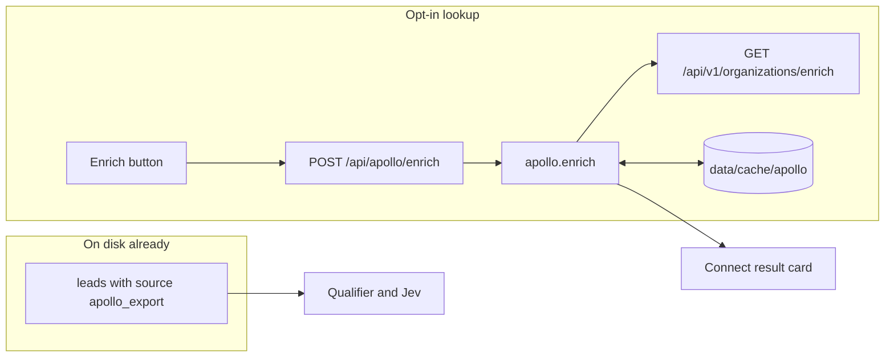
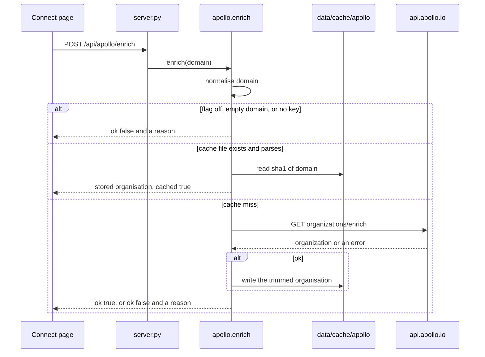

# How First Read uses Apollo

Date: 2026-11-17. Related: [architecture at a glance](../ARCHITECTURE-AT-A-GLANCE-v1.md), [architecture](../ARCHITECTURE.md).

Apollo appears in three roles. Only one of them leaves the machine.

| Role | Where | Calls Apollo? |
| --- | --- | --- |
| Optional organisation lookup | Connect page, `leadqualifier/apollo.py` | Yes, one company per click, when the flag is on |
| Demo leads shaped like an export | `data/leads/*.json` with `"source": "apollo_export"` | No. The files are hand-written and already on disk |
| A described input | Connect card "Instantly · Apollo replies" | No. The card is static copy in `web/app.js` |

Scoring, the Jev request, the CRM shortlist, and the gold metrics never read an Apollo response. The lookup result is rendered on the Connect page and, on success, stored under `data/cache/apollo/`.



## The live call

`POST /api/apollo/enrich` with `{"domain": "..."}` calls `apollo.enrich`. The handler returns that dict as JSON. A refused lookup is still HTTP 200 with `"ok": false`. The button handler prints `Not enriched: {reason}`.

The request is synchronous on the FastAPI worker that served the click. It does not enter the scoring thread pool (`FIRSTREAD_WORKERS`).



### When the button is live

Both of these have to hold, via `config.apollo_enabled()`:

- `APOLLO_ENRICH` is `1`, `true`, `yes`, or `on`
- `APOLLO_API_KEY` is set and does not start with `your-`

`run.sh` loads those from the environment or `.env`. A value already in the shell wins. The key is sent only as the `x-api-key` header. It is not logged and it is not returned by `/api/status`.

`/api/status` includes:

```json
"apollo": { "enabled": false, "has_key": true, "flag": false, "cached": 0 }
```

`enabled` and `flag` are the same boolean today: both are `apollo_enabled()`. `has_key` is independent, so a key with the flag off still shows up. The Connect pill uses that split:

| Status | Pill | Button |
| --- | --- | --- |
| Enabled | `enabled · N cached` | clickable |
| Key present, flag off | `key present · flag off (APOLLO_ENRICH=1)` | disabled |
| No key | `off — no key` | disabled |

`cached` is the count of `*.json` files in the Apollo cache directory. The count does not open the files.

### What is sent

Apollo's [Organization Enrichment](https://docs.apollo.io/reference/organization-enrichment) endpoint enriches one company. First Read calls the URL pinned in `apollo.py`:

`GET https://api.apollo.io/api/v1/organizations/enrich?domain={domain}`

Headers: `x-api-key` (Apollo's API-key header for this API; a bearer token is the wrong scheme and Apollo answers 401) and `Cache-Control: no-cache`. Timeout is 8 seconds. There is no retry loop. People search, bulk organisation enrich, and sequences are not called from this repo.

`normalise_domain` lowercases the input, strips a scheme and a path, and drops a leading `www.`. `https://www.Example.com/about` becomes `example.com`, which matches the form Apollo asks for. An empty result after that returns `{"ok": false, "reason": "no domain"}` and does not call out.

### What is kept

A 200 with an `organization` object is trimmed before it is shown or written. Phone objects, the Apollo organisation id, social URLs other than LinkedIn, and the rest of the payload are dropped on the way in.

| Apollo field | Stored as |
| --- | --- |
| `name` | `organization.name` |
| `website_url` | `organization.website` |
| `industry` | `organization.industry` |
| `estimated_num_employees` | `organization.employees` |
| `founded_year` | `organization.founded` |
| `city`, `country` | `organization.city`, `organization.country` |
| `linkedin_url` | `organization.linkedin` |
| `short_description` | `organization.description`, cut at 600 characters |
| `keywords` | `organization.keywords`, first 12 |
| `annual_revenue_printed` | `organization.revenue` |

The card shows name, industry, employees, city, country, founded year, revenue, the description, up to 8 keywords, and whether the row was `cached` or `live`.

A cache miss that returns a company is a live enrich on that Apollo account, billed however that account's plan bills enrichment. A cache hit does not call Apollo.

### Cache

```text
data/cache/apollo/{first 16 hex chars of SHA-1(normalised domain)}.json
```

`data/cache/` is git-ignored. The file is the success body (`ok`, `domain`, `organization`) without a `cached` flag. On read, `enrich` adds `"cached": true`. A file that is not JSON is ignored and the request goes to Apollo.

Only `ok: true` is written. HTTP errors, connection errors, and "no organization" stay uncached so the next click can try again. `DELETE /api/cache` clears Jev answers in `data/cache/answers.json`. It leaves `data/cache/apollo/` in place.

### Failures

Every handled failure is `{"ok": false, "reason": "..."}`. Scoring is unchanged.

| Condition | `reason` |
| --- | --- |
| Domain normalises to empty | `no domain` |
| Flag off or key missing | `Apollo enrichment is off (set APOLLO_ENRICH=1 and APOLLO_API_KEY)` |
| `httpx` error | `connection error: {exception class name}` |
| HTTP status 400 or above | `Apollo returned HTTP {status}` — the body is discarded |
| 200 with an empty `organization` | `no organization found for this domain` |

A 200 whose body is not JSON is not caught inside `enrich`; FastAPI surfaces it as a server error. `tests/test_server.py::test_apollo_is_gracefully_off` posts a domain with the flag unset and asserts `ok` is false and the reason contains `off`.

## Demo leads that look like an Apollo export

Twelve lead files use `"source": "apollo_export"`: `L014`, `L028`–`L035`, `L046`, `L056`, `L059`. `scripts/make_dataset.py` writes them. They are fictional company profiles: name, domain, description, size, location, services, sometimes a news sentence, sometimes a person. `message` is null, so `Lead.shape` is `profile` (or `bio` if a bio is what the file carries).

`Lead.to_state` labels `lead_source` as `Apollo export` and sends the company and person fields already in the file. Jev judges that text. Nothing in `Qualifier.score` calls `apollo.enrich`, and a click on Enrich does not write back into `data/leads/`.

For a profile, `build_questions` omits the six message-only questions (`is_vendor_pitch`, `asks_for_meeting`, `urgency`, `objection_present`, `is_spam_or_automated`, `contains_pii_request`). Intent from a meeting ask and from urgency stays at zero. The lead page flag `no_message` says intent comes from news and bio only.

Pasting an enriched description into a lead file would make it part of the next Jev state, because the state is whatever is in the lead. The running app does not do that paste.

## The Connect card that only describes Apollo

`renderConnect` in `web/app.js` builds four input rows from a constant list. One of them is "Instantly · Apollo replies": reply webhooks, the thread as the message, the export row as the profile. The pill on that row is the literal string `webhook · CSV`. There is no route, no signature check, and no writer that turns an Apollo webhook into a lead.

The same page's output cards (HubSpot, Pipedrive, Attio, calendar, sequence) are the same kind of copy. The Enrich card above them is the integration that actually runs.
