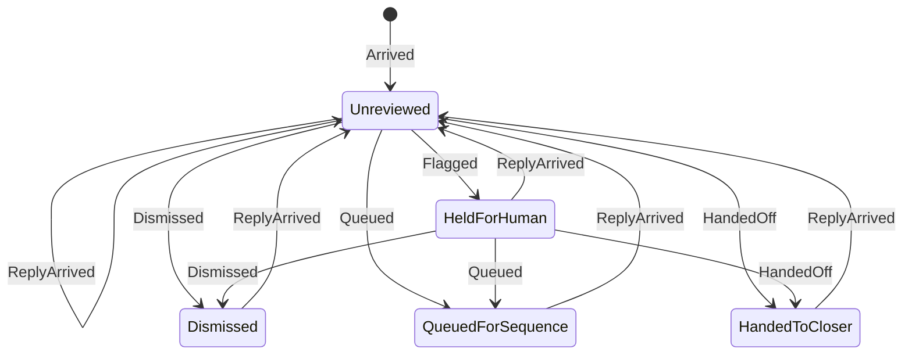

# At a glance v1 — intake, rank, handoff

Hub: [[HANDOFF-MEMORY|hub]]. Census, not this page: the six research notes linked under Evidence. Burials: [[TOMBSTONES|tombstones]].

**Confirmed 2026-11-17.** The owner executed the follow-through plan against this version. The Decider in this file is the sketch; the match that is law is in `leadqualifier/workitem.fsx` and is folded by [[ARCHITECTURE]]. Open points listed below are settled there, not by editing this sketch.

Browser smoke 2026-11-18: Apollo `auth/health` 200; People Search 403 `AUTH.AUTHORIZATION.ENDPOINT_ACCESS_DENIED` on the Free plan. HubSpot write still off (no token, no test contact). Details in [[HANDOFF-MEMORY]] and [[2026-11-17-journal]].

## The story

A person names who they are hunting (plumbers, insurance agencies) as a saved profile. The app asks Apollo for people who match that profile, stores each person, and ranks them with the scorer that already exists. A hot judgement is written onto the contact in HubSpot for a closer. A warm judgement is marked ready for a sequence this app does not send. A reply comes back as text, is ranked again, and a hot reply is the handoff.

CSV import is the same door when the list did not come from the search call. Organisation enrich decorates a company we already have. It is not how a list is born.

## The shape

This product owns the work item, the profile versions, the answer ledger, and the outbox. Apollo owns the people database. HubSpot owns the closer's account. The scorer stays a pure fold of answers under one profile version. The tier is a read model. The disposition is the aggregate.

```fsharp
type Arrival =
    | ApolloPerson of personId: string
    | CsvRow of importId: string * row: int
    | Reply of parent: WorkItemId

type Tier = Hot | Warm | Nurture | Disqualify | Existing

type Judgement =
    | Unjudged
    | Judged of version: IcpVersionId * tier: Tier

type Disposition =
    | Unreviewed
    | HeldForHuman
    | Dismissed
    | QueuedForSequence
    | HandedToCloser

type Relay =
    | NoWrite
    | Pending
    | Delivered of remoteId: string
    | Failed of reason: string
```

`Judgement` is rebuilt from the answer rows plus the profile version. It is not a second status column. `Relay` is the outbox for the HubSpot write, idempotent on the work item and the profile version.

## What it replaces, and how

| Flow | Target | Replaces | How |
| --- | --- | --- | --- |
| Find people | Apollo people search inserts a work item per person | T1 in [[TOMBSTONES]]. The fixed `data/leads` folder as the only population | Search filters come from the saved profile. CSV insert is the same birth with `CsvRow` |
| Switch target | Save a profile version. Rescore from answers whose fingerprints still match | T2 in [[TOMBSTONES]]. `icp.save` overwriting `data/icp.json` | The version id is what an answer was judged under |
| Rank | Existing `assemble`, unchanged | nothing in the scorer | One Jev request for missing fingerprints. The answer row is written when the response arrives |
| Remember the answer | A row per lead, question id, fingerprint | T3 in [[TOMBSTONES]]. `answers.json` flushed at the end of `score_many` | Crash mid-run keeps the rows already returned |
| Decide | Disposition Decider below | [[2026-11-17-disposition-is-a-score]] recomputed and forgotten | A person accepts, dismisses, or hands off. The score can still say held |
| Hand to the closer | Outbox write of tier, route, fit, intent, pain, next action. Existing account gets a note | T5 in [[TOMBSTONES]]. The Connect card whose pill says `API` | HubSpot is the writer. T4 in [[TOMBSTONES]] is buried when that read is live |
| Decorate a company | Organisation snapshot on the account, with fetched-at | T6 in [[TOMBSTONES]]. A file named by the domain hash alone | Enrich still spends a call. The snapshot is what a later score can cite |

## The Decider

Proposed. No `apply` exists to diff against. Refusals are arms of `decide`, drawn as notes because a refusal is not a new case.



`Queued` and `HandedOff` and `Flagged` refuse with `NotJudged` while `Judgement` is `Unjudged`. `HandedOff` refuses with `NotHot` unless the tier is `Hot`. `Queued` refuses with `NotSequenceable` when the tier is `Disqualify` or `Existing`. A second `Dismissed` on `Dismissed` refuses with `AlreadyDismissed`. `ReplyArrived` is the one event that leaves `Dismissed`.

## Evidence

| Claim the target stands on | Where it was measured |
| --- | --- |
| Leads are 65 files. 12 are `apollo_export`. No SQLite | [[2026-11-17-where-leads-live]] |
| Answers stay in memory until `score_many` ends | [[2026-11-17-answer-store-durability]] |
| One ICP file. Presets overwrite it | [[2026-11-17-icp-is-one-file]] |
| The only Apollo call is organisation enrich | [[2026-11-17-apollo-is-not-intake]] |
| HubSpot is a string in `web/app.js` | [[2026-11-17-crm-and-hubspot-are-copy]] |
| `needs_review` is not a stored decision | [[2026-11-17-disposition-is-a-score]] |

## What this deliberately does not do

- It does not replace `scoring.py`. The fold stays the rank.
- It does not send email, place calls, or drop ringless voicemail. `QueuedForSequence` is a decision. A sequencer this product does not own performs it.
- It does not become a HubSpot product. The write is the judgement properties, or a note on an account that already exists.
- It does not rewrite the page in Next.js.
- It does not move `data/gold.json` into the ledger. Gold is the demo's answer key.

## Still open

Settled in [[ARCHITECTURE]] §1, 2026-11-17. This sketch is not rewritten.

- Reply reopens the same item. `Arrival` in the oracle has no `Reply` case.
- No sequencer is bound in this arc.
- Contact is derived from disposition (`contactOf`).
- Profile → Apollo filters is a port, measured in the intake wave.
- HubSpot names live in the adapter. T4 stays planned.
- One operator.
