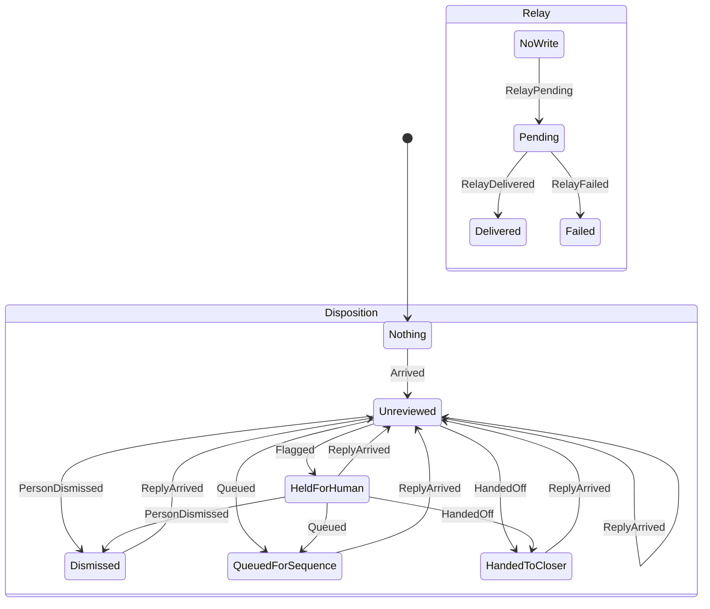

# Architecture — intake, rank, handoff

Hub: [[HANDOFF-MEMORY]]. Confirmed glance: [[ARCHITECTURE-AT-A-GLANCE_v1_intake-rank-handoff]]. Oracle: `leadqualifier/workitem.fsx`. Board: [tickets/INDEX.md](tickets/INDEX.md). Burials: [[TOMBSTONES]].

The glance is the direction. This file is that direction folded: types, the match, the waves. Host Python is ported from the oracle. It is not re-derived from this prose.

## §0 Rules this design obeys

- F# owns the types. The host language is the messenger. `leadqualifier/workitem.fsx` is the spec. `dotnet fsi` on that file is the gate (`./run.sh oracles`).
- Illegal states are unrepresentable. `State` is `Nothing` or `Open` of arrival, disposition, and relay. `Judgement` is not a field of `State`. Contact is a function of disposition, not a stored boolean.
- The aggregate refuses. `decide` returns `Error` of a named `Refusal`. `evolve` returns `Error NotArrived` for an event that has no arm. Nothing is skipped.
- What this product owns is event-sourced on the work item. Status of the person is a one-way ratchet except `ReplyArrived`, which returns the item to `Unreviewed`.
- An entity we do not own is a reference. Apollo people and HubSpot companies are foreign identities. Provenance is part of the id (`PersonId`, a HubSpot remote id on `Delivered`).
- `leadqualifier/scoring.py` `assemble` stays the rank. This arc does not replace it.
- One operator on one machine. No tenant id.
- 🔴 UNENFORCED until the host is ported: only the oracle admits the transitions. A Python caller can still ignore them. The porting tickets name that gap.

## §1 Bounded contexts

| Context | Owns | Reads | Writes through |
| --- | --- | --- | --- |
| Work item | Birth, disposition, HubSpot relay | Judgement from the rank | `decide` / `evolve` |
| Rank | Nothing new. `assemble` under one ICP version | Answer rows, the live profile version, CRM shortlist | Zero. It is a fold |
| Answer ledger | One row per work item, question id, fingerprint | — | Written when Jev returns, not at the end of a batch |
| Profile | Named versions. The live version is the one the rank uses | — | Save produces a new version id. It does not overwrite history |
| Apollo people | Nothing. Foreign | Search hits, organisation enrich | Ports: `Search`, `EnrichPerson`, `EnrichOrg` |
| HubSpot | Nothing. Foreign | Companies, for dedupe, only after T4 | Outbox: properties on the contact, or a note when the account exists |
| Sequencer | Nothing | `QueuedForSequence` as a fact | A port this arc does not bind. Apollo sequences and Instantly both send. The product does not send |

CSV import is the same door as Apollo search. The birth is `CsvRow`, not a second aggregate.

### Settled from the glance's open list

| Open on the glance | Ruling |
| --- | --- |
| Reply as a new work item vs reopen | Reopen. `Arrival` has no `Reply` case. `RecordReply` on an open item emits `ReplyArrived` and `evolve` returns `Unreviewed`. L19, L20 |
| Which sequencer receives `Queued` | None in this arc. Disposition is the fact. Binding a sender is a later arc |
| When the email is revealed | Derived: `Hidden` on `Nothing`, `Unreviewed`, `Dismissed`. `Revealed` on `HeldForHuman`, `QueuedForSequence`, `HandedToCloser`. L22–L26 |
| Profile prose to Apollo filter ids | A port `Profile → SearchFilters`. The map is measured in the intake wave, not invented here |
| HubSpot property names, T4 | Adapter maps our names (`tier`, `route`, `fit`, `intent`, `primary_pain`, `next_action`). Dedupe stays `data/crm.json` until T4 |
| Tenant | One operator |

## §1b The diagram

Drawn from `decide` / `evolve` in `leadqualifier/workitem.fsx` on 2026-11-17. Rendered with mermaid-cli 10.2.4 as `research/tools/2026-11-17-workitem.png`.

Refusals are not cases. They are `Error` from `decide`: `NotArrived`, `AlreadyArrived`, `NotJudged`, `NotHeld`, `NotHot`, `NotSequenceable`, `NotQueueable`, `AlreadyDismissed`, `NotDismissable`, `AlreadyHandedOff`, `NotHandoffable`, `RelayNotPending`. `evolve` refuses any pair with no arm as `NotArrived` (L32).

`HandOff` of `Hot` from `Unreviewed` or `HeldForHuman` emits `HandedOff` then `RelayPending` in one `decide` (L14).



## §2 Contract, compile order

One file, loads nothing: `leadqualifier/workitem.fsx`. Types first, then `decide`, `evolve`, `fold`, `apply`, `contactOf`, then the laws.

```fsharp
type Arrival = ApolloPerson of PersonId | CsvRow of ImportId * row: int
type Judgement = Unjudged | Judged of IcpVersionId * Tier * needsReview: bool
type State = Nothing | Open of Arrival * Disposition * Relay
```

`Tier` is `Hot | Warm | Nurture | Disqualify | Existing`, the same five strings `assemble` already returns.

A judgement is rebuilt:

```
answers_for(id, fingerprints(profile_version)) |> assemble(profile_version) |> Judged
```

Missing fingerprints stay `Unjudged`. `Flag`, `Queue`, and `HandOff` then refuse `NotJudged`.

## §3 Oracle

`./run.sh oracles` reads `leadqualifier/ORACLES` (`EXPECTED 1`, `leadqualifier/workitem.fsx 0 33`) and requires `0 failed` and `LAWS ≥ 33`.

RED-proven 2026-11-17: `Dismiss` on `Dismissed` mutated from `Error AlreadyDismissed` to `Ok [PersonDismissed]`. Run printed `FAIL exception: L17: expected Error AlreadyDismissed, got Ok` then `16 passed, 1 failed`. Restored. Green again: `33 passed, 0 failed`.

Law index (the floor is 33, not this list's length in prose):

| | Law |
| --- | --- |
| L1 | Arrive on `Nothing` → `Unreviewed`, `NoWrite` |
| L2 | Second Arrive → `AlreadyArrived` |
| L3 | Flag while `Unjudged` → `NotJudged` |
| L4 | Flag when `needsReview` → `HeldForHuman` |
| L5 | Flag when not `needsReview` → `NotHeld` |
| L6–L8 | Queue while `Unjudged` / of `Disqualify` / of `Existing` refuse |
| L9–L11 | Queue of Warm, Hot, Nurture → `QueuedForSequence` |
| L12–L13 | HandOff while `Unjudged` or not Hot refuse |
| L14–L15 | HandOff of Hot → `HandedToCloser` and `Pending`; second HandOff → `AlreadyHandedOff` |
| L16–L18 | Dismiss from Unreviewed; second Dismiss; Dismiss from Queued |
| L19–L20 | `ReplyArrived` leaves Dismissed and HandedToCloser |
| L21 | `CsvRow` is a birth |
| L22–L26 | Contact hidden / revealed |
| L27–L28 | Deliver only from `Pending` |
| L29 | Commands on `Nothing` |
| L30–L31 | Queue and HandOff from `HeldForHuman` |
| L32 | `evolve` refuses `Arrived` on `Open` |
| L33 | `State` has no judgement field |

## §4 Journeys

Each journey is an oracle path. The smoke is named on the wave that ships the host port.

1. **Find and rank.** Search or CSV → `Arrive` → missing fingerprints asked of Jev → answer rows written → `assemble` → `Judged`. Smoke: a CSV of two rows becomes two `Open` items; one run writes answer rows before the process exits.
2. **Hold.** `needsReview` true → `Flag` → `HeldForHuman` → contact `Revealed`. Smoke: a lead the gate would flag shows in the review queue.
3. **Sequence.** Warm, not review → `Queue` → `QueuedForSequence`. Smoke: the item is listed as queued. No mail is sent.
4. **Closer.** Hot → `HandOff` → `Pending` → adapter writes HubSpot → `MarkDelivered`. Smoke: a test contact in a test portal shows `tier=hot`. Failure → `MarkFailed`, relay `Failed`, disposition stays `HandedToCloser`.
5. **Reply.** Any disposition → `RecordReply` → `Unreviewed` → rank again. Smoke: a dismissed item that receives a body of text is `Unreviewed` and `Unjudged` until the new answers land.
6. **Switch profile.** Save a new version. Fingerprints that moved are missing. Rescore from cache for the rest. Smoke: raising the revenue threshold re-tiers cached items with zero Jev calls, same as today's `POST /api/rescore`.

## §5 Elmish, waves, decisions, patterns

### Elmish

The URL is the location: `#pipeline`, `#lead/{id}`, `#icp`, `#review`. The lead page holds a `WorkItemId`, not the entity. Load is `Deferred`. A stale SSE result is dropped by sequence number, as today's run already streams.

`Mode` on the lead: `Viewing | Reviewing`. `Reviewing` is only reachable when disposition is `HeldForHuman`. Commands `Flag`, `Dismiss`, `Queue`, `HandOff` are `Cmd`s returned from `update`, not `useEffect` fetches.

Keep `web/app.js` as the host of that Elmish shape. This arc does not introduce Next.js.

### Waves

| Wave | Ships | Smoke that closes it |
| --- | --- | --- |
| 1 Ledger | SQLite work items and answer rows. Jev answers are written when they return (T3). The 65 files seed the store (T1) | Kill a run after lead 10. Restart. Those ten still have answers. `./run.sh test` green |
| 2 Profile | Named versions. Save does not overwrite history (T2). Judgement carries `IcpVersionId` | Save, change a pain, save again. Two versions on disk. Rescore of an old version still matches its answers |
| 3 Intake | CSV `CsvRow`. Apollo people search `ApolloPerson`. Organisation enrich writes a snapshot on the account (T6 may wait until wave 6) | CSV of three real-shaped rows appear on the pipeline. Search with a measured filter set inserts rows that `Arrive` |
| 4 Disposition | Host port of `decide` / `evolve`. Review queue. Contact reveal | Flag, Dismiss, Queue, HandOff, RecordReply each refuse as the oracle does. A dismissed item does not show an email |
| 5 Handoff | HubSpot outbox (T5). Properties or a note | A test contact receives `tier`. A second HandOff is `AlreadyHandedOff` and does not write again |
| 6 Decorate | Organisation snapshot on the account (T6). T4 stays planned until the closer's HubSpot is the dedupe read | Enrich of a domain already on a work item stores `fetched_at` on the account, not a hashed file alone |

T4 is not a wave in this arc. It waits on a HubSpot company read that replaces `data/crm.json`. Named on the tombstone.

### Decisions

| Decision | Take | Alternative named |
| --- | --- | --- |
| Store | SQLite, one file, beside `data/` | Postgres. Rejected until a second process needs the rows |
| Reply | Event on the same item | Child work item. Rejected: two dispositions for one person |
| Email | Derived `contactOf` | Stored boolean. Rejected: can disagree with disposition |
| Sequencer | Unbound port | Bind Instantly or Apollo now. Rejected: unmeasured |
| UI host | Keep `web/` | Next.js. Rejected by the glance |
| Rank | Keep `assemble` | Reimplement in F#. Rejected: the fold is already the rank |
| HubSpot | Outbox of the judgement | Marketplace app, deals, workflows. Rejected by the glance |

### Patterns, named

- **Decider** (Chassaing): `decide` / `evolve` on the work item.
- **CQRS**: the pipeline board is a read model of `Open` rows plus a rebuilt `Judgement`.
- **Transactional outbox**: `Relay Pending` is the outbox item. The adapter delivers, then `MarkDelivered` / `MarkFailed`.
- **Reference vs derived**: Apollo person id and HubSpot remote id are references. The board is derived. Answer rows are reference data (PART II: a record we wrote is kept).
- **Fingerprint cache**: unchanged from `leadqualifier/cache.py`. The durability changes: a row, not a file flushed at the end of `score_many`.

## §6 Review ledger

Round 1 — 2026-11-17 — a reading, not a gate. The ruler document does not exist. Archived at [research/archive/2026-11-17-review-r1.md](research/archive/2026-11-17-review-r1.md).

Score: **14 / 15**. Tickets may be cut.

The missed criterion: which arm production reaches is unmeasured. No `HandOff` has ever run. The oracle admits it. That is LAW 4's blind spot, named.

Settled: v1 glance confirmed, this architecture folded from it.

## §14 As built

Nothing in the host is ported. The oracle and the roster exist. `leadqualifier/scoring.py`, `pipeline.py`, `cache.py`, `data/leads/`, `data/icp.json`, and `web/app.js` still behave as the 2026-11-17 census. Departures from this design are the whole of today's process. They close ticket by ticket, not by a silent dual stack.
