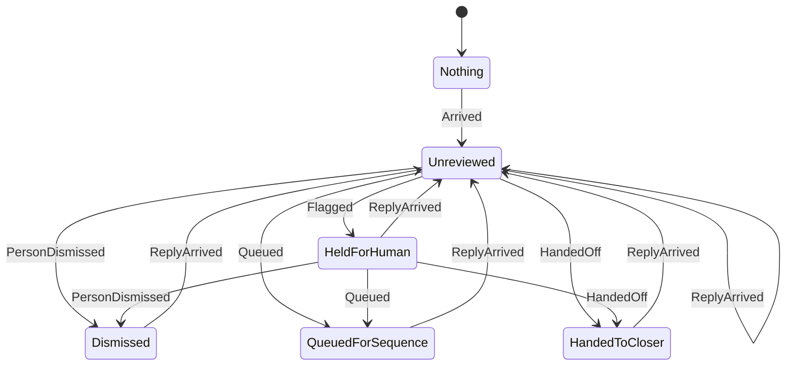
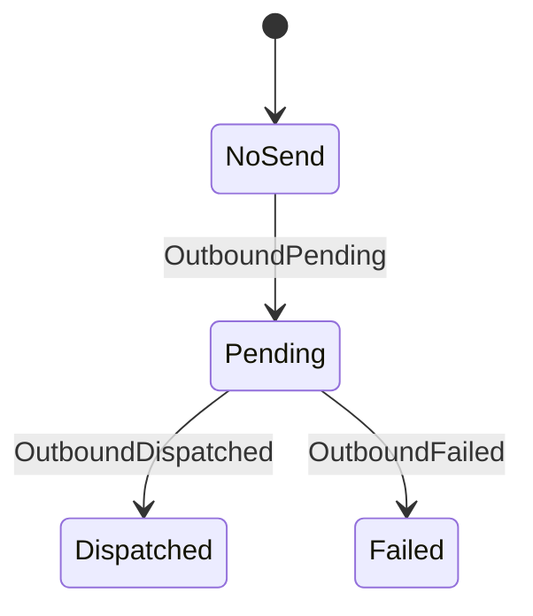

# At a glance v1 — comms layer

**Superseded 2026-11-18 by [[ARCHITECTURE-AT-A-GLANCE_v2_comms-layer]].** Keep as evidence of what waves 0–4 built against. The leak: Instantly named as a destination (L27, L61). Cost: [[2026-11-18-instantly-named-as-destination]].

Hub: [[HANDOFF-MEMORY|hub]]. Census: the five research notes under Evidence. Parent glance (intake): [intake v1](../2026-11-17-intake-rank-handoff/ARCHITECTURE-AT-A-GLANCE_v1_intake-rank-handoff.md).

**Confirmed 2026-11-17.** The owner executed the follow-through plan against this version. The match that is law is in `leadqualifier/workitem.fsx`.

## The story

A person scores a lead. Queue on a warm or hot judgement means "this draft may leave the building." Hand off on a hot judgement means "offer the founder slots, and write HubSpot." Another app sends. A reply comes back as text on the same person, is ranked again, and a hot reply is the handoff. A polite decline stays a draft a human glances. Nothing auto-sends from the rank.

## The shape

This product owns the work item and its outboxes. Instantly / a dialer / HubSpot are destinations. The scorer stays a pure fold. Channel is a union, not a string on the playbook.

```fsharp
type Channel = Email | LinkedIn | Voice

type Draft = { Channel: Channel; Body: string; CallSlots: string list }

type Outbound =
    | NoSend
    | Pending of Draft
    | Dispatched of remoteId: string
    | Failed of reason: string

type State =
    | Nothing
    | Open of Arrival * Disposition * Relay * Outbound
```

`Relay` stays HubSpot. `Outbound` is the sequencer / dialer slot. Two HubSpot pendings remain unspeakable. Instantly is not a second spelling of `Relay`.

Disposition is authorization. Unreviewed and Dismissed never grow a new `Pending`. HeldForHuman is revealed and still `NoSend` until Queue or HandOff. Nurture Queue is a decision with `NoSend` (newsletter track, no personal send). Disqualify stays `not_sequenceable`. Decline is not a command in this version.

Contact visibility (`contactOf`) does not change. Email bytes live on the Lead. Revealed plus no address is a visible unknown — FakeComms refuses `no_address`.

A reply is `RecordReply` of a non-empty body. `Arrival` has no `Reply` case.

## What it replaces, and how

| Flow | Target | Replaces | How |
| --- | --- | --- | --- |
| Queue a warm lead | `Queued` then `OutboundPending` of Email draft | Queue today writes disposition only ([[2026-11-18-queue-does-not-dispatch]]) | FakeComms.dispatch, then `MarkDispatched` |
| Hand off a hot lead | existing HubSpot `RelayPending` **and** `OutboundPending` of Voice | HandOff today only HubSpot ([[2026-11-18-relay-is-one-slot]]) | Two destinations, two drains |
| Record a reply | `ReplyArrived` of body, payload `message.text` becomes that body, Unreviewed, rescore | `RecordReply` unit ([[2026-11-18-record-reply-has-no-body]]) | Same work item. Empty text refuses |
| Show the draft | Channel + outbox on `#lead/{id}` | Playbook string with no channel ([[2026-11-18-playbook-is-a-string]]) | Queue / Hand off stay the authorize buttons |
| Live email | Instantly `POST /api/v2/leads` behind env | unbound sequencer | Fake stays default. Test campaign only |

## The Decider

Drawn from the target match. Refusals are notes because a refusal is not a new case.



Outbound (sequencer slot, beside HubSpot `Relay`):



`Queue` of Warm or Hot emits `Queued` then `OutboundPending`. `Queue` of Nurture emits `Queued` only. `HandOff` of Hot emits `HandedOff`, `RelayPending`, `OutboundPending`. Empty draft / empty reply refuse. `MarkDispatched` only from `Pending`.

## Evidence

| Claim the target stands on | Where it was measured |
| --- | --- |
| Queue of Warm → `QueuedForSequence`, no send | [[2026-11-18-queue-does-not-dispatch]] |
| `RecordReply` is a unit command | [[2026-11-18-record-reply-has-no-body]] |
| Playbook is a filled string | [[2026-11-18-playbook-is-a-string]] |
| `Relay` is one HubSpot slot | [[2026-11-18-relay-is-one-slot]] |
| Demo leads have no email field | [[2026-11-18-reveal-can-be-empty]] |

## What this deliberately does not do

- It does not replace `scoring.py`.
- It does not auto-send from `assemble`.
- It does not mint `SendDecline`.
- It does not bind Twilio, Cal.com, or a scraper fleet.
- It does not smash Instantly into `Relay`.
- It does not add a `Reply` arm on `Arrival`.
- It does not rewrite the page in Next.js.

## Still open

- Which Voice vendor. Unnamed. FakeComms is the Voice host.
- Instantly live smoke. Waits on the owner's key, campaign id, and a test address.
- `SendDecline` as a later command, not this version.
