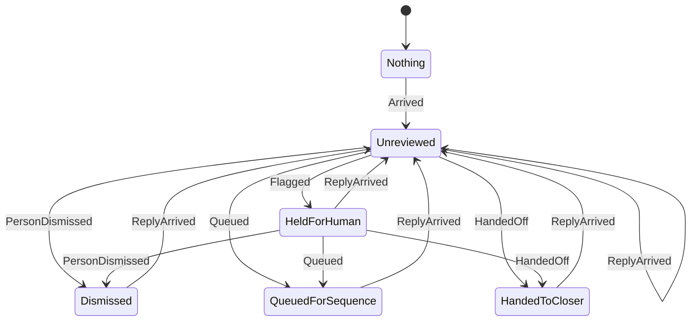
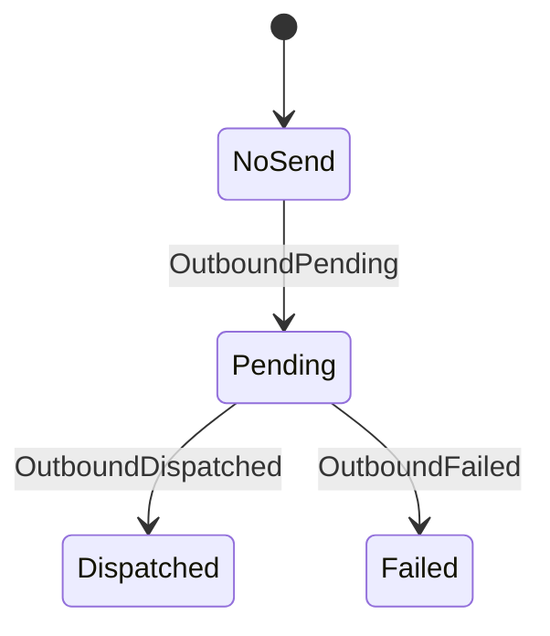

# At a glance v2 — channel is not a vendor

**Superseded 2026-11-18 by [[ARCHITECTURE-AT-A-GLANCE_v3_integrations]].** Keep as evidence of what waves 5–7 built against. The hole: composition still swapped Email on `INSTANTLY_SEND`, and Connect was brochure copy.

Hub: [[HANDOFF-MEMORY|hub]]. Supersedes [[ARCHITECTURE-AT-A-GLANCE_v1_comms-layer]]. Parent glance (intake): [intake v1](../2026-11-17-intake-rank-handoff/ARCHITECTURE-AT-A-GLANCE_v1_intake-rank-handoff.md).

**Confirmed 2026-11-18.** Owner ruling: InstantlyComms as an acceptance name is a host leak. The match that is law is `leadqualifier/workitem.fsx` (floor 56 after wave 5). Census: the research notes under Evidence.

## The story

A person scores a lead. Queue on a warm or hot judgement means "this draft may leave the building." Hand off on a hot judgement means "offer the founder slots, and write HubSpot." **Another app** sends — this product does not own the mailbox, the number, or the dialer. A reply comes back as text on the same person, is ranked again, and a hot reply is the handoff. A polite decline stays a draft a human glances. Nothing auto-sends from the rank.

The pipe is a **channel**. The sentence or link that leaves is an **offer**. The company that actually delivers is a **host binding**. Those three are not the same word.

## The shape

This product owns the work item and its outboxes. HubSpot is the CRM this product already relays. Email, SMS, voice, LinkedIn, ringless voicemail are channels. A vendor name is not a destination and not a type on the aggregate.

```fsharp
type Channel =
    | Email
    | LinkedIn
    | Voice
    | Sms
    | RinglessVoicemail

type Offer =
    | Copy of text: string
    | CaseStudy of url: string
    | QualifyingQuestion of text: string
    | Calendar of slots: string list
    | Form of url: string
    | DeclineDraft of text: string

type Draft = { Channel: Channel; Offer: Offer }

type Outbound =
    | NoSend
    | Pending of Draft
    | Dispatched of remoteId: string
    | Failed of reason: string

type Comms = {
    dispatch: WorkItemId * Channel * Draft -> Result<RemoteId, DispatchError>
}

// HOST only. The concept never stores this map.
type Bindings = Map<Channel, Comms>

type InboundHint =
    | ByWorkItem of WorkItemId
    | ByEmail of string
    | ByPhone of string

type InboundMatch =
    | Matched of WorkItemId
    | UnknownSender
```

`Relay` stays HubSpot. `Outbound` is one pending slot for sequencer / dialer / SMS / RVM. Two HubSpot pendings remain unspeakable. A vendor remote id is not stored in `Relay`.

Disposition is authorization. Unreviewed and Dismissed never grow a new `Pending`. HeldForHuman is revealed and still `NoSend` until Queue or HandOff. Nurture Queue is a decision with `NoSend`. Disqualify stays `not_sequenceable`. `DeclineDraft` is glanced, not sent, until a later `SendDecline` ticket.

A host that has not bound a channel refuses `channel_unbound`. FakeComms is the default binding for every channel that has no live vendor. An Email adapter does not mention Voice.

A reply is `RecordReply` of a non-empty body. The host turns a vendor event into `InboundMatch`, then `RecordReply`. `Arrival` has no `Reply` case. `UnknownSender` is loud; it is not a new work item.

## What it replaces, and how

| Flow | Target | Replaces | How |
| --- | --- | --- | --- |
| Queue a warm lead | `Queued` then `OutboundPending` of an Email draft | Queue as disposition-only ([[2026-11-18-queue-does-not-dispatch]]) | Drain the **Email** binding, then `MarkDispatched` |
| Hand off a hot lead | HubSpot `RelayPending` **and** `OutboundPending` of Voice | HandOff as HubSpot-only ([[2026-11-18-relay-is-one-slot]]) | Two destinations, two drains. Voice adapter is not the Email adapter |
| Record a reply | `ReplyArrived` of body, Unreviewed, rescore | operator paste only ([[2026-11-18-inbound-is-paste]]) | Host `InboundMatch` then `RecordReply`. Empty text refuses |
| Show the draft | Channel + Offer + outbox on `#lead/{id}` | playbook sentence ([[2026-11-18-offer-is-untyped]]) | Queue / Hand off stay the authorize buttons |
| Swap a sender | a new file on `Bindings[channel]` | one global Instantly-or-Fake ([[2026-11-18-one-global-comms]]) | Concept still sees `Comms`. No vendor in `decide` |
| Live send | owner's named vendor, behind env, test address only | glance v1 "Live email = Instantly POST" ([[2026-11-18-instantly-named-as-destination]]) | Operational. Not a type. Not an acceptance name |

## The Decider

Drawn from the target match. Refusals are notes because a refusal is not a new case.



Outbound (one slot beside HubSpot `Relay`):



`Queue` of Warm or Hot emits `Queued` then `OutboundPending`. `Queue` of Nurture emits `Queued` only. `HandOff` of Hot emits `HandedOff`, `RelayPending`, `OutboundPending`. Empty offer / empty reply refuse. Nonempty `DeclineDraft` refuses `NotSendable` (`SendDecline` is not a command here). `MarkDispatched` only from `Pending`. Unbound channel refuses at the host, not in `decide`.

## Evidence

| Claim the target stands on | Where it was measured |
| --- | --- |
| Queue of Warm → `QueuedForSequence`, no send in `decide` | [[2026-11-18-queue-does-not-dispatch]] |
| `RecordReply` now carries a body; the door is still paste | [[2026-11-18-record-reply-has-no-body]], [[2026-11-18-inbound-is-paste]] |
| Playbook is a filled string; 0 URLs | [[2026-11-18-playbook-is-a-string]], [[2026-11-18-offer-is-untyped]] |
| `Relay` is one HubSpot slot | [[2026-11-18-relay-is-one-slot]] |
| Demo leads have no email field | [[2026-11-18-reveal-can-be-empty]] |
| Glance v1 named Instantly as a destination; oracle has 0 InstantlyComms | [[2026-11-18-instantly-named-as-destination]] |
| `default_comms` is Instantly or Fake, one value | [[2026-11-18-one-global-comms]] |

## What this deliberately does not do

- It does not replace `scoring.py`.
- It does not auto-send from `assemble`.
- It does not mint `SendDecline` in this version.
- It does not put a vendor name on the aggregate, the glance shape, or a ticket's acceptance.
- It does not smash any sequencer into `Relay`.
- It does not add a `Reply` arm on `Arrival`.
- It does not add a scraper ABC or a NotificationService.
- It does not rewrite the page in Next.js.

## Still open

- Which vendor the owner names for each channel. Fake is the default until named. A name is a host file, not a glance edit.
- Whether `Form` and `CaseStudy` URLs exist as real assets, or `Copy` is the only reachable offer until then. Do not invent URLs.
- `SendDecline` as a later command.
