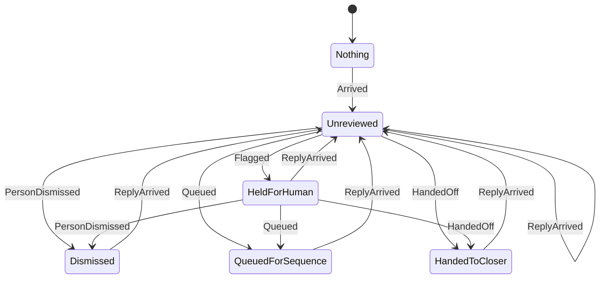
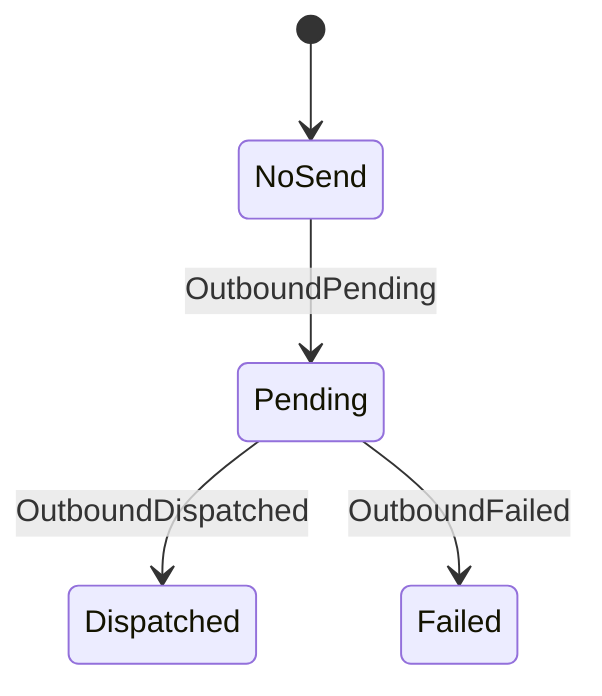
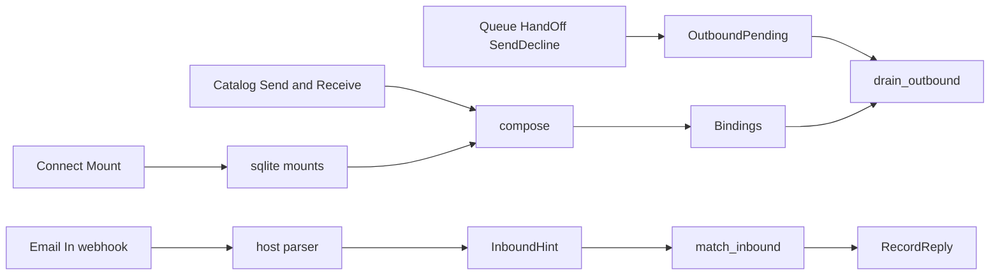

# At a glance v4 — SendDecline, Receive, catalog files

Hub: [[HANDOFF-MEMORY|hub]]. Supersedes [[ARCHITECTURE-AT-A-GLANCE_v3_integrations]]. Parent glance (intake): [intake v1](../2026-11-17-intake-rank-handoff/ARCHITECTURE-AT-A-GLANCE_v1_intake-rank-handoff.md).

**Confirmed 2026-11-18.** Owner ruling: close glance v3's remaining operational opens. Live Email on a test address; SendDecline; Twilio SMS and Voice as catalog files; Instantly reply as a Receive plugin. LinkedIn, ringless voicemail, and CaseStudy/Form URLs stay Fake or Copy — those APIs or assets were measured absent. HubSpot stays Relay/env. Vendor words stay out of both `.fsx` files. The match that is law is `leadqualifier/workitem.fsx` and `leadqualifier/integrations.fsx`. Census: the research notes under Evidence.

## The story

A person scores a lead. Queue on a warm or hot judgement means "this draft may leave the building." Hand off on a hot judgement means "offer the founder slots, and write HubSpot." **Send decline** on a disqualify judgement means "this polite decline may leave, and the person is dismissed." **Another app still sends.** This product does not own the mailbox, the number, or the dialer.

The pipe is a **channel**. The sentence or link that leaves is an **offer**. The company that actually delivers is a **plugin** the operator mounts onto a slot. Unmounted Out is Fake. A plugin that only sends Email cannot occupy Voice. Two plugins on Email Out is unspeakable.

A **Receive** capability is not a Channel Out slot. Out mounts stay `Map<Channel, Mount>`. Receive mounts are a second map (Email only this arc). Unmounted Receive is a 404 at the webhook door. Mounted Receive is a host parser that becomes `InboundHint`, then the existing `match_inbound`. `decide` never sees vendor JSON. `Arrival` still has no `Reply` case.

`decide` still does not send. A vendor is a catalog file, not an acceptance name.

## The shape

This product owns the work item and its outboxes. HubSpot is the CRM this product already relays — not a Comms plugin, not a Connect card. Email, SMS, voice, LinkedIn, ringless voicemail are Channel Out slots. Receive Email is a second occupancy. One Out slot per Channel. One Receive slot per Channel.

```fsharp
type Channel =
    | Email
    | LinkedIn
    | Voice
    | Sms
    | RinglessVoicemail

type Offer =
    | Copy of text: string
    | CaseStudy of url: string
    | QualifyingQuestion of text: string
    | Calendar of slots: string list
    | Form of url: string
    | DeclineDraft of text: string

type Draft = { Channel: Channel; Offer: Offer }

type Outbound =
    | NoSend
    | Pending of Draft
    | Dispatched of remoteId: string
    | Failed of reason: string

type Command =
    | Arrive of Arrival
    | Flag
    | Dismiss
    | Queue of Draft
    | HandOff of Draft
    | SendDecline of Draft
    | RecordReply of body: string
    | MarkDelivered of remoteId: string
    | MarkFailed of reason: string
    | MarkDispatched of remoteId: string
    | MarkDispatchFailed of reason: string

type Comms = {
    dispatch: WorkItemId * Channel * Draft -> Result<RemoteId, DispatchError>
}

// HOST only. The concept never stores this map.
type Bindings = Map<Channel, Comms>

type Direction = Out | In

type Capability =
    | Send of Channel
    | Receive of Channel

type PluginId = PluginId of string   // opaque label; never a vendor word in the oracle

type Catalog = Map<PluginId, Set<Capability>>

type Mount =
    | Unmounted
    | Mounted of PluginId

type Mounts = Map<Channel, Mount>          // Out occupancy
type ReceiveMounts = Map<Channel, Mount>   // In occupancy; not an Out slot

type ComposeError =
    | UnknownPlugin
    | CapabilityMismatch

type InboundHint =
    | ByWorkItem of WorkItemId
    | ByEmail of string
    | ByPhone of string

type InboundMatch =
    | Matched of WorkItemId
    | UnknownSender
```

`compose catalog mounts` is total on Channel **Out**: Unmounted → Fake; Mounted → that plugin's adapter **only if** `Send ch` is in its set. Receive occupancy is a second map; it does not fill Bindings. A missing Bindings key remains `channel_unbound` (mis-compose). Unmounted Out is **not** `channel_unbound`. Mounted Out and the process lacks the credential is `plugin_unready` on dispatch — Fake is not silently kept while sqlite says Mounted.

Unmounted Receive → webhook 404. Mounted Receive → host parser → `InboundHint` → `match_inbound`. Other vendor event types are ignored (204), not `unknown_sender`. Empty reply is the existing `empty_reply`.

`Relay` stays HubSpot. Secrets stay in the process environment. The UI stores mounts (a plugin id on a slot). Status may say `ready` / `needs_credential`. Never the value. Env is resolved at process start — after adding a key, restart.

Disposition is authorization. Unreviewed and Dismissed never grow a new `Pending` except **SendDecline** of a nonempty `DeclineDraft` on Disqualify, which emits `PersonDismissed` then `OutboundPending`. Empty `DeclineDraft` is `EmptyDraft`. Any other Offer is `NotSendable`. Not Disqualify is `NotSequenceable` (reuse). Contact stays Hidden on Dismissed; drain still reads `payload_json` address. Nurture Queue stays `NoSend`. Queue / HandOff of nonempty `DeclineDraft` stay `NotSendable`.

A reply is `RecordReply` of a non-empty body. The host turns a vendor event into `InboundMatch`, then `RecordReply`. `Arrival` has no `Reply` case. `UnknownSender` is loud; it is not a new work item.

## What it replaces, and how

| Flow | Target | Replaces | How |
| --- | --- | --- | --- |
| Queue a warm lead | `Queued` then `OutboundPending` of an Email draft | Queue as disposition-only ([[2026-11-18-queue-does-not-dispatch]]) | Drain `Bindings[Email]`, then `MarkDispatched` |
| Hand off a hot lead | HubSpot `RelayPending` **and** `OutboundPending` of Voice | HandOff as HubSpot-only ([[2026-11-18-relay-is-one-slot]]) | Two destinations, two drains. Voice adapter is not the Email adapter |
| Send a polite decline | `PersonDismissed` then `OutboundPending` of Email + DeclineDraft | Decline glanced, not sent (v3) | Drain whatever Email is mounted. Contact stays Hidden |
| Record a reply | `ReplyArrived` of body, Unreviewed, rescore | operator paste only ([[2026-11-18-inbound-is-paste]]) | Host `InboundMatch` then `RecordReply`. Email In is a Receive mount |
| Show the draft | Channel + Offer + outbox on `#lead/{id}` | playbook sentence ([[2026-11-18-offer-is-untyped]]) | Queue / Hand off / Send decline are the authorize buttons |
| Occupy Out | operator Mount / Unmount on `#connect` | brochure Connect ([[2026-11-18-connect-is-brochure]]); `INSTANTLY_SEND` Email swap ([[2026-11-18-instantly-send-is-the-email-switch]]) | sqlite `comms_mount`; compose; Fake fills Unmounted Out |
| Occupy Email In | operator Mount / Unmount on the Email In card | paste as the only inbound door | sqlite `comms_receive`; unmounted is 404 |
| Live credential | env key present → `ready`; absent → `needs_credential` / `plugin_unready` | keys imagined in sqlite ([[2026-11-18-secrets-are-not-mounts]]) | Never the value on the wire. Restart after adding a key |
| Live Email | owner's word: POST on `INSTANTLY_TEST_EMAIL` | glance v1 "Live email = Instantly POST" ([[2026-11-18-instantly-named-as-destination]]); `INSTANTLY_SEND` skip | Catalog factory. Skip unless key + campaign + test email |
| SMS / Voice Out | catalog files `sms-plugin` / `voice-plugin` | empty Voice candidates (v3) | Named Twilio routes. No live POST until the owner says so |
| LinkedIn Out / RVM Out | stay Fake | inventing a send that is not there | [[2026-11-18-instantly-is-not-linkedin]], [[2026-11-18-twilio-is-not-rvm]] |
| CaseStudy / Form | stay Copy | invented URLs | [[2026-11-18-playbook-has-no-urls]] |

## The Decider

Drawn from the target match. Refusals are notes because a refusal is not a new case.



Outbound (one slot beside HubSpot `Relay`):



Compose (host):



`Queue` of Warm or Hot emits `Queued` then `OutboundPending`. `Queue` of Nurture emits `Queued` only. `HandOff` of Hot emits `HandedOff`, `RelayPending`, `OutboundPending`. `SendDecline` of Disqualify emits `PersonDismissed` then `OutboundPending`. Empty offer / empty reply refuse. Queue / HandOff of nonempty `DeclineDraft` refuse `NotSendable`. `MarkDispatched` only from `Pending`. Unbound channel refuses at the host, not in `decide`. Capability mismatch refuses at Mount, not in `decide`. Unmounted Receive refuses at HTTP 404, not in `decide`.

## Evidence

| Claim the target stands on | Where it was measured |
| --- | --- |
| Queue of Warm → `QueuedForSequence`, no send in `decide` | [[2026-11-18-queue-does-not-dispatch]] |
| `RecordReply` now carries a body; the door is still paste | [[2026-11-18-record-reply-has-no-body]], [[2026-11-18-inbound-is-paste]] |
| Playbook is a filled string; 0 URLs | [[2026-11-18-playbook-is-a-string]], [[2026-11-18-offer-is-untyped]], [[2026-11-18-playbook-has-no-urls]] |
| `Relay` is one HubSpot slot | [[2026-11-18-relay-is-one-slot]] |
| Demo leads have no email field | [[2026-11-18-reveal-can-be-empty]] |
| Glance v1 named Instantly as a destination; oracle has 0 InstantlyComms | [[2026-11-18-instantly-named-as-destination]] |
| `default_comms` was Instantly or Fake, one value | [[2026-11-18-one-global-comms]] |
| Connect is brochure copy; `INSTANTLY_SEND` is the Email switch | [[2026-11-18-connect-is-brochure]], [[2026-11-18-instantly-send-is-the-email-switch]] |
| Secrets are env, not sqlite mounts | [[2026-11-18-secrets-are-not-mounts]] |
| Instantly create-lead with `campaign` requires `email`; no LinkedIn send route | [[2026-11-18-instantly-is-not-linkedin]] |
| Twilio does not offer ringless voicemail (ToS) | [[2026-11-18-twilio-is-not-rvm]] |

## What this deliberately does not do

- It does not replace `scoring.py`.
- It does not auto-send from `assemble`.
- It does not put a vendor name on the aggregate, the oracle, or a ticket's acceptance.
- It does not smash any sequencer into `Relay`.
- It does not put HubSpot on the Connect board.
- It does not store keys in sqlite or return them from JSON.
- It does not add a `Reply` arm on `Arrival`.
- It does not parse vendor JSON in `inbound.py` or in `decide`.
- It does not invent a LinkedIn send because Instantly exists.
- It does not invent a ringless-voicemail send because Twilio exists.
- It does not invent CaseStudy / Form URLs.
- It does not add a scraper ABC or a NotificationService.
- It does not rewrite the page in Next.js.

## Still open

- Live Twilio POST on a test number — owner's word after this machine exists. Not this glance's smoke.
- Live Instantly webhook pointing at a reachable URL — owner's campaign, not this laptop unless they say so.
- LinkedIn Out and RinglessVoicemail Out stay Fake until a named API exists.
- CaseStudy / Form stay Copy until the owner types named URLs.
